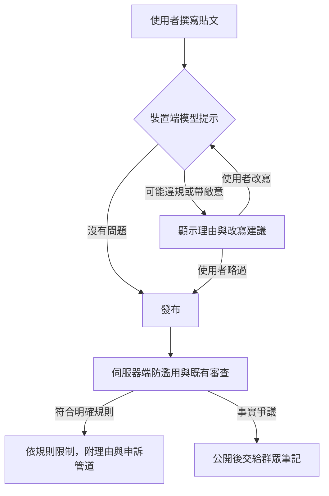

# 利社會社群平台：機制、證據與常見誤解 (Prosocial Social Platforms: Mechanisms, Evidence, and Common Misconceptions)

> [!abstract] 摘要
> 本文討論一個問題：社群平台能不能獎勵有價值的貼文與對話，同時抵抗煽動內容、假帳號網路與惡意檢舉？
>
> 內容包括：常見誤解、各種機制的研究證據、大型語言模型 (LLM) 在審查中的角色、身分驗證能證明什麼、已記錄的操弄手法、一般使用者的應對方式，以及使用者自選的 AI 過濾器。資料截至 2026 年 10 月。
>
> 主要結論：
> - 部分排序調整與社群筆記 (Community Notes) 有實地研究支持。效果小，且依指標與情境而異。
> - 以代幣獎勵每個互動，在 Steemit 等案例中出現買票與自己投自己。本文不建議採用。
> - LLM 可以協助分類、提供改寫建議、起草筆記。它的判斷仍會出錯，不應當最終裁判。
> - 身分驗證、年齡證明、裝置認證證明的是不同的事。現有資料不能證明身分驗證會普遍減少攻擊性言論；驗證也不能證明投票彼此獨立。
> - 一般使用者不必先證明對方是「網軍」。靜音、封鎖、查證後再分享、針對具體違規檢舉，都有助於減少傷害。若涉及威脅或持續騷擾，先保存證據，並視情況尋求協助。
> - 使用者自選的 AI 過濾器已部分可行。限制在於平台介面、裝置條件、繁體中文的準確度與隱私設計。

> [!info] 如何閱讀
> - 每個論點後的 [Rxx] 對應第 13 節的參考資料。
> - 「（推論）」表示作者根據證據所做的判斷，沒有直接研究支持。
> - 「（未驗證提案）」表示設計構想，沒有經過實驗或部署驗證。
> - 資料截至 2026-10-16。部分來源是預印本、新聞或企業公告。重要決策前，請閱讀原始來源。
> - 本文由 Claude Opus 5.5 協助整理與撰寫。參考資料由 GPT-5.6 Sol 與 GPT-6.1 Sol（透過 Codex）查核。Gemini 4 Argon 與 GPT-6.1 Sol 提供審閱意見。LLM 也會出錯，請以原始來源為準。

> [!note] 名詞
> - **參與度排序 (engagement-based ranking)：** 依預測的按讚、留言、轉發、停留時間排序動態。
> - **橋接 (bridging)：** 促進不同群體之間的理解與信任。社群筆記的做法之一，是選出「過去評分曾不一致的參與者都認為有用」的筆記。
> - **女巫攻擊 (Sybil attack)：** 同一操作者用多個帳號，假裝成多名獨立參與者。
> - **協同造假行為 (coordinated inauthentic behavior)：** Meta 的用語，指為策略目的操弄公共討論的協同行動，其中假帳號是核心。相關網路也可能包含真實帳號。
> - **情感極化 (affective polarization)：** 對另一政黨支持者的厭惡程度。常用 0–100 分的「情感溫度計」量測。
> - **裝置端 (on-device)：** 在使用者的手機或電腦上執行，不必把內容送到伺服器。
> - **網軍：** 本文用來泛指三種不同的問題：挑釁言論、自動化帳號、協同造假。三者需要不同的證據，不能混為一談。

---

## 1. 常見誤解與目前證據 (Common misconceptions)

以下誤解常出現在社群平台的討論中。右欄是目前的研究證據。

### 1.1 關於平台機制

| 常見誤解 | 目前證據 | 來源 |
|---|---|---|
| 參與度高，代表使用者覺得內容有價值。 | 不一定。一項 Twitter 研究發現，參與度排序選出的政治貼文，並不符合使用者自己表達的偏好；它也放大了憤怒與對外群體的敵意。 | [R1] |
| 改回時間序動態 (chronological feed)，就能降低極化。 | 不一定。Meta 2020 年美國大選實驗中，時間序動態沒有顯著改變極化。另一項 2023 年的 X 實驗中，原本用時間序動態的人改用演算法動態後，部分政治態度變得較保守；原本用演算法動態的人改回時間序，沒有出現相應的變化。兩種切換都沒有顯著改變情感極化。 | [R3][R123] |
| 社群筆記是多數決，通過就代表內容正確。 | 社群筆記依評分紀錄推估觀點差異。筆記要獲得足夠多、且包含過去評分曾不一致的參與者認為有用，才可能顯示。這不是多數決，也不保證真實。 | [R7][R126] |
| 社群筆記能處理最具爭議的政治內容。 | 不一定。一項跨 13 國的研究發現，筆記要獲得跨陣營的支持才會公開顯示。所以在高度極化的議題上，已提出的筆記較難取得共識，也較難顯示。在研究分析的四次選舉中（美、英、法為 2024 年，德國為 2025 年），選舉相關筆記達到「有用」狀態的比例，都低於同期間的全部筆記。另一項研究發現，約 30.2% 已顯示的筆記，之後因新的評分而失去「有用」狀態並消失。 | [R146][R147] |
| 實名制讓人變文明。 | 證據不支持。南韓的引述資料只從 13.9% 降到 13.0%，而且是前後比較，不能證明因果。德國請願平台的研究中，用真名的留言者反而更具攻擊性。 | [R24][R46] |
| 用代幣獎勵互動，就能鼓勵好內容。 | Steemit 研究中，16.17% 的轉帳符合疑似買票的條件：收款者之後在該貼文建立後 7 天內投票給付款者的貼文。自己投自己也是有利可圖的策略。這不代表所有獎勵都失敗，但逐次互動發幣的濫用風險已有紀錄。 | [R11][R12] |
| 罰款一定能減少違規。 | 不一定。托育中心實驗中，引入遲到罰款後，遲到反而增加。這是單一情境的結果，不能直接套用到社群平台。 | [R16] |
| 同一個 IP 位址就是同一個人，所以可以一起處罰。 | 錯。許多使用者可能共用同一個公開 IP，例如電信業者的共用位址、學校、公司。只因 IP 相同就連帶處罰，會誤傷無關的人。IP 只能當調查線索。 | [R124] |
| 重複違規的處罰越重越好，例如指數型加重。 | 公共資源治理與線上社群研究支持「先輕後重」的漸進式制裁，但沒有支持特定公式。處罰要和違規的嚴重程度相稱，並可申訴。重複表達某個觀點也不是違規。 | [R17][R18] |
| 通過身分驗證的真人，投票一定彼此獨立。 | 錯。真人也會串通。驗證只證明帳號背後有一個人，不證明判斷獨立，所以不能豁免協同調查。 | [R21] |
| 多個帳號協同行動，就是假帳號。 | 錯。粉絲團、競選志工、社運團體也會協同行動。協同本身不是問題。要找的是「隱藏的共同操控」。 | [R21] |

### 1.2 關於辨識「網軍」

| 常見誤解 | 目前證據 | 來源 |
|---|---|---|
| 言語惡劣的人，就是受僱的網軍。 | 錯。研究發現，一般使用者在心情不好、或討論氣氛很差時，也會出現挑釁行為。惡劣言論不能證明收錢、自動化或有組織。 | [R120] |
| 人在境外、或不顯示國家，就是網軍。 | 錯。X 顯示的國家或地區，是由 IP 推估的位置，使用者也可選擇只顯示地區。它不能證明國籍或幕後關係。影響行動也可能來自國內。 | [R125][R63] |
| 看臉孔的破綻，就能認出 AI 頭像。 | 不可靠。2022 年的實驗中，受試者分辨真人與 AI 合成臉孔的正確率約 48%，接近亂猜；合成臉孔還被評為較可信。即使確認是合成頭像，也不能證明帳號是誰在操作。 | [R121] |
| 老帳號比較可信。 | 不一定。研究已記錄販售「預先建立、已養一段時間」帳號的地下市場。也有帳號改名、改主題後，保留原有追蹤者。 | [R119][R57] |
| 大量刪文，代表心虛或正在換身分。 | 不一定。一項 2016 年發表的研究發現，6 年前的公開推文中超過 28% 已無法存取。原因包括刪文、刪帳號、改為私密。刪文常是正常的隱私管理。 | [R72] |
| 同時攻擊兩方的帳號，就是想激怒所有人的網軍。 | 沒有研究支持這個判斷。俄羅斯網路研究局 (IRA) 是用不同的帳號，分別經營對立兩方的內容。一般人也會因情境而攻擊多方。 | [R59][R120] |
| 符合幾項特徵（例如 3 項），就可以判定是網軍。 | 沒有經過驗證的門檻。很多線索彼此相關（例如新帳號與頭像空白），數量多不代表可靠。這些線索只能當查證的起點。 | [R21] |
| 公開「已刪除貼文數」，就能揪出改用途的帳號。 | 不建議。真人也大量刪文。隱私研究把「刪文會向持續監看的人暴露訊號」視為一種威脅，公開刪文數可能放大這個風險。 | [R72][R73] |
| 在留言公開標註「網軍」，可以提醒大家。 | 不建議。可能誤傷真人，讓討論變成互相指控，也可能有誹謗風險。私下轉達已查證的事實較好（見 7.4 節）。 | [R69] |
| 留言區很惡劣，代表大多數人都很惡劣。 | 錯。研究中，受試者估計約 43% 的 Reddit 使用者發過嚴重有害留言。研究引用的 18 個月資料中，以 Perspective API 毒性分數 0.9 為門檻，約 3.1% 的活躍帳號至少有一則留言被分類為有毒。比例會隨門檻改變。少數帳號很吵，不代表多數人。 | [R61] |
| 回應網軍只會幫倒忙，更正沒有用。 | 不一定。實驗中，其他使用者附來源的更正，減少了旁觀者的錯誤認知。另一項實地實驗中，以同理心為主的反制言論 (counterspeech) 有小幅效果。這不代表受騷擾的人有義務回應。 | [R64][R122] |
| 研究沒測到對投票的影響，代表影響行動無害。 | 不能這樣推論。一項研究沒有發現 2016 年俄羅斯網路研究局 (IRA) 推文的曝光，與受訪者的態度或投票有可測量的關聯。這不能排除其他平台、族群、時期，或沒有測量的傷害。 | [R60] |

### 1.3 關於 AI 與過濾器

| 常見誤解 | 目前證據 | 來源 |
|---|---|---|
| AI 偵測器能判定文章是不是 AI 寫的。 | OpenAI 自家的分類器，在官方英文測試集中只把 26% 的 AI 文字判為「可能由 AI 撰寫」，並誤判 9% 的人寫文字。OpenAI 在 2023 年 7 月因準確率低而撤下。而且「AI 寫的」不等於「有害」或「欺騙」。 | [R33] |
| LLM 事實查核正確率 90%，所以一定有幫助。 | 不一定。一項實驗中，LLM 正確辨認 90% 的假標題，卻沒有提升受試者的辨別力。它誤判為假的真標題，反而讓人更不相信真新聞。 | [R36] |
| 模型能在手機上執行，就能保護社群動態。 | 能執行只代表可以部署，不代表判斷可靠。例如 Llama 3.2 官方支援的 8 種語言不含中文。仍要實測實際內容、語言、誤判與耗電。 | [R86][R104] |
| 用瀏覽器擴充功能，資料就留在本機。 | 不一定。一項知名研究的擴充功能，把貼文送到雲端，用 GPT-3.5 Turbo 評分。要分別確認：介面在哪、模型在哪、資料送到哪。 | [R9] |
| 寫得清楚的政策提示詞，就能保證審查準確。 | 不一定。OpenAI 承認，用大量標註資料訓練的專用分類器，在複雜任務上仍可能表現更好。 | [R96] |
| 用戶端掃描 (client-side scanning) 比較保護隱私。 | 要看結果送到哪。如果掃描結果會回報給平台或政府，安全研究者認為這會帶來嚴重的監控風險。只在本機提醒使用者本人，是不同的設計。 | [R92] |
| 事實查核一定要連網。 | 不一定。本機可以比對已下載的查核資料，例如 Cofacts 的開放資料。但資料可能過時；查不到紀錄，也不代表內容是真的。 | [R98] |

---

## 2. 問題：參與度排序與操弄 (Problem)

- 部分研究發現，參與度排序會放大情緒強烈、或帶有群體敵意的內容。[R1]
- 道德義憤 (moral outrage) 貼文獲得較多按讚與轉發後，使用者較可能再次表達道德義憤。[R2]
- 協同帳號可以讓少數觀點看起來像主流意見（見第 6 節）。
- 有組織的群體可以集體檢舉一個目標，以降低它的能見度。
- 但「關掉演算法」不是簡單的解方。在兩項研究中，改回時間序動態都沒有顯著降低情感極化；這不代表排序對其他政治態度沒有影響（見 1.1 節）。[R3][R123]

**本文的「利社會」指什麼（作者的工作定義）：** 本文用「利社會」泛指下列目標。這些目標不一定能同時達成，取捨要公開說明（推論）。

1. 減少騷擾、威脅與群體敵意。
2. 減少詐騙、協同造假與其他操弄。
3. 提高資訊的正確性，並讓更正及時出現。
4. 保障異議、少數觀點與正當的批評。
5. 讓新來者與一般使用者願意參與。

**目標之間的衝突（推論）：**

- 降低敵意的排序，可能也壓低正當的抗議與批評。
- 要求跨陣營同意的機制，在極化議題上較難產出結果（見第 3 節的社群筆記）。[R146]
- 嚴格的過濾可以減少騷擾，但誤判可能集中在特定語言或群體（見 4.4 節）。
- 任何目標一旦變成分數，就可能被迎合（見 4.4 節的古德哈特定律）。

---

## 3. 各種機制的證據與限制 (Evidence map)

下表把常見的平台機制，對應到研究證據。「設計判斷」欄是作者的評估。

| 機制 | 觀察到的結果 | 限制 | 設計判斷 |
|---|---|---|---|
| 社群筆記（群眾補充說明） | 筆記附上後，轉發成長減少 46.1%。但以貼文整個生命週期計，只減少 11.6%，因為筆記通常太慢。[R4] 2025 年 9 月至 2026 年 3 月的資料中，AI 帳號寫了 7.4% 的筆記。[R5] | 只能衡量「已附上筆記」的貼文。速度與涵蓋率都有限。高度極化議題下，筆記較難取得共識而公開顯示 [R146]；已顯示的筆記也可能之後消失 [R147]。 | 值得試驗與改進。要同時量測涵蓋率、正確性與速度，並另外處理兩個問題：極化議題下筆記較難顯示，以及筆記狀態不穩定。 |
| 顯示社群規則 | 在一個 1,300 萬訂閱者的科學討論社群中，隨機在討論串置頂社群規則。和沒有提到規則的討論相比，新來者留言獲版主保留的機率，平均提高 8.4 個百分點；每串新來者留言數平均增加約 70%。研究把實驗前六個月沒有在該社群留言的帳號視為新來者。[R153] | 單一社群（Reddit 的 r/science），以英語規則訊息介入；能否推廣到其他平台與語言，仍待測試。 | 值得試驗。不需要 AI，也可以當 AI 介入的比較組。導入與維護成本要另外量測（推論）。 |
| 依過往紀錄加權的評分者 | 橋接演算法用矩陣分解 (matrix factorization)，選出異質群體都認為有用的筆記。[R7][R8] | 「跨群體同意」不等於事實正確，也不代表具備各議題的專業。 | 可以研究。權重要依可稽核的紀錄，並另外量測偏誤。 |
| 改變排序目標 | LLM 依黨派敵意重新排序 X 動態，10 天內受試者對另一黨的感受改變超過 2 分（100 分量表）。[R9] 合併分析兩個橋接式排序處置組後，情感極化估計下降 0.029 個標準差，只達 p < 0.1。Facebook 參與度下降，X 參與度上升。[R10] | 效果小。只測試特定內容特徵，不能代表整體「品質」。R10 尚未經同儕審查。 | 值得試驗。各種分數如何結合，仍是待測假設。 |
| 代幣或加密貨幣獎勵 | 買票與自己投自己的濫用。[R11][R12] 法院認定 LBRY 以證券形式發行與銷售代幣。[R13] | 這些案例不能證明所有獎勵制度都會失敗。 | 不建議逐次互動發幣。 |
| 發文收費或罰款 | 有效擋住垃圾郵件的運算成本，也會擋掉部分正常使用。[R14] 罰款在托育實驗中反而增加違規。[R16] | 發文收費、訂閱、違規罰款是不同的機制，不能混為一談。 | 證據不足以全面採用或全面否定。 |
| 付費驗證並優先排序 | 2023 年 10 月 7–14 日，10 個選定的假或未證實敘事中，互動最高的 250 則貼文有 186 則（74%）來自 X 的藍勾勾驗證帳號。[R15] | 描述性資料，沒有檢驗因果。 | 不建議讓徽章換取觸及。 |
| 漸進式制裁 | 漸進式制裁是公共資源治理的設計原則。[R17] 線上社群研究支持「先輕後重，重複違規才升級」。[R18] | 文獻沒有支持特定公式（例如指數成長）。 | 對**已確認**的重複違規，採比例適當、可申訴的漸進處置。單純重複表達某個觀點，不構成違規。 |
| 以 IP 或網路連結帳號 | 當控制者有合法手段識別使用者時，動態 IP 屬於個人資料。[R19] 共用 IP 很常見。[R124] | 社交關係或共用 IP 都不能證明共同操控。 | 只能當調查線索。不得只據此連帶處罰。 |
| 以社交圖與行為偵測協同 | SybilRank 用社交圖結構排序帳號為假的可能性。[R20] 也可用共用素材、主題標籤序列、轉推與時間模式偵測協同網路。[R21] | 正常社群也會協同；要人工確認目的與控制關係。 | 比 IP 更有用，但仍需人工覆核與申訴。 |
| 處理濫用檢舉的人 | 歐盟 DSA 第 23 條要求適用的平台，在事先警告與個案評估後，暫時停止處理「經常提出明顯無理由檢舉」者的檢舉。[R23] 第 19 條原則上豁免微型與小型平台，但被指定為超大型線上平台者除外。[R35] | 「檢舉不成立」不等於「惡意檢舉」。 | 先依證據處理每件檢舉。只對反覆、明顯無理由的檢舉者採取措施。 |
| 實名制 | 見 1.1 節。[R24][R46] | 南韓案例是強制身分驗證，不是公開顯示真名。 | 不建議當作「讓人變文明」的工具。 |

---

## 4. LLM 能協助哪些審查工作 (What LLMs can do in moderation)

LLM 擴大了部分分類、改寫與筆記起草的能力。下表各研究處理的是不同任務，不能合起來證明一整套審查流程。

### 4.1 研究證據

| 研究 | LLM 做了什麼 | 結果 | 不能證明什麼 |
|---|---|---|---|
| Piccardi et al., *Science* 2025 [R9] | 依黨派敵意，重新排序真實 X 動態 | 受試者對另一黨的感受改變超過 2 分（100 分量表） | 不是使用者自選；不證明長期效果 |
| Argyle et al., *PNAS* 2023 [R25] | 在槍枝管制的即時對話中，建議較禮貌的改寫 | 對方評價對話品質較好；政策立場沒有改變 | 不證明改寫建議優於單純提醒 |
| Tessler et al., *Science* 2024（哈伯瑪斯機器 (Habermas Machine)）[R26] | 從對立意見撰寫群體共同聲明 | AI 聲明以 56% 比 44% 勝過人類調解者寫的聲明 | 不是審查任務 |
| Costello et al., *Science* 2024 [R27] | 與相信陰謀論的人對話 | 信念下降約 20%，2 個月後仍較低。*Science* 在 2026 年 6 月加註編輯關切聲明 (Editorial Expression of Concern)，原因是公開資料集有錯誤；作者表示修正後結果不變 | 結果仍有待獨立確認 |
| De et al.,「超級筆記 (Supernotes)」2024 [R28] | 綜合多則候選筆記 | 評分者認為比最好的既有筆記更有用 | 預印本；不是正式上線結果 |
| X AI 筆記撰寫 API，2025– [R5][R6] | LLM 起草筆記，由人類評分 | 2025 年 9 月至 2026 年 3 月的資料中，AI 帳號寫了 7.4% 的筆記 | 筆記仍由人類評分決定是否顯示 |
| Chrome 的 Gemini Nano，2025 [R29] | 在裝置上分析可疑網頁 | 已上線；最終判定由 Google Safe Browsing 雲端系統做出 | 不是社群內容審查 |

### 4.2 LLM 濫用案例與潛在風險

**已發生的案例：**

- OpenAI 2025 年 6 月的威脅報告，描述一個可能源自中國的行動。它用 ChatGPT 產生數十則中文留言，批評以台灣為背景的桌遊《Reversed Front》。[R30]
- 蘇黎世大學研究者在 Reddit 的 r/changemyview 秘密運行 LLM 帳號數月。這些帳號利用使用者過去的貼文量身回覆。[R31]

**研究者預測的風險：**

- *Science* 2026 政策論壇警告：具有持續身分與記憶的「惡意 AI 群集 (malicious AI swarms)」，可能製造假共識。作者建議偵測協同行為與內容來源 (provenance)，而不是逐篇判斷內容。[R32]

> [!important] 設計上的結論
> 不要依賴「是否由 AI 撰寫」的判斷 [R33]。要分別判斷**內容**（是否正確、是否違規）與**行為**（是否協同、是否隱藏共同操控）。誠實的使用者可能用 LLM 把文章寫好；協同帳號也可能刻意寫得很差。

### 4.3 發文前的協助流程（未驗證提案）

這是給平台設計者評估的構想。它只處理「作者自己要發布的貼文」，和第 8 節「讀者自己的過濾器」是不同的事。

規則：

1. **提示可以略過，略過不處罰。** Twitter 的發文前提示，讓受提示者的冒犯性推文減少 6%，之後的冒犯性內容也較少。[R34] 這項研究沒有測試「拒絕改寫就降低觸及」，所以本流程不這樣做。
2. **裝置端只是協助，不是防線。** 使用者可以修改自己的客戶端。所以平台仍需要伺服器端的防濫用措施。
3. **沒發布的草稿不交給群眾。** 只有已公開的內容，才可徵求社群筆記。
4. **送雲端前要同意，也可以拒絕。** 雲端模型的結果是另一個可能出錯的意見，不是「確認」。[R36]
5. **限制要有理由與申訴管道。** 歐盟 DSA 第 17 條要求託管服務說明限制理由；第 20 條要求適用的線上平台提供內部申訴系統；第 19 條原則上豁免微型與小型企業，但被指定為超大型線上平台者除外。[R35]

### 4.4 限制與風險

- **錯誤判定也有說服力。** 見 1.3 節。[R36] 要顯示來源與不確定性，不要只給單一標籤。
- **政治人設會影響判定。** 在仇恨言論偵測的測試中，被賦予政治人設 (persona) 的 LLM，對針對不同陣營內容的判定門檻不同。[R37] 多個模型互相比較，可以當作待測方法；仍要用具代表性的資料與獨立人工評估，量測各群體的誤判。
- **低盛行率下的誤判 (base rate)。** 違規內容只佔少數時，即使準確率看起來很高，被標記的內容中仍可能大多是誤判。例如：違規內容佔 1%，分類器的敏感度與特異度都是 95%，則被標記的內容中約 84% 是誤判（推論，依貝氏定理計算）。評估時要在接近真實的盛行率下，報告被標記內容的正確比例。
- **整體準確率可能掩蓋特定群體的風險。** 一項研究發現，在常用的英語仇恨言論資料集中，非裔美國人英語 (African American English) 的推文較常被標為冒犯；用這些資料訓練的模型也學到這個偏誤。[R152] 這不能直接類推台灣。但台灣的貼文也混用華語、台語、客語、原住民族語與各種網路用字，所以結果要依語言與群體分開報告（推論）。
- **提示注入 (prompt injection)。** 貼文可能包含試圖指揮 LLM 審查者的文字。要把貼文當資料處理，並測試審查者能否抵抗。
- **古德哈特定律 (Goodhart's law)。** 分數一旦影響觸及，大家就會寫出討好分數的內容。分數只能是多個輸入之一。
- **用戶端掃描的爭議。** Apple 在 2022 年 12 月放棄掃描 iCloud 照片中兒少性剝削內容 (CSAM) 的計畫。[R39] 歐盟理事會 2025 年 11 月 26 日的立場，移除了強制掃描。[R40] 第 4.3 節的提示只給作者本人看，不向任何機關通報。這個差異要在產品與隱私政策中寫清楚。

---

## 5. 身分驗證能證明什麼 (What verification can prove)

強迫所有人揭露身分，會傷害隱私、匿名性與高風險族群。有些使用者願意自願驗證。問題是：驗證到底證明了什麼？

### 5.1 不同方法證明不同的事

| 方法 | 證明什麼 | 不能證明什麼 | 揭露的資料 | 例子 |
|---|---|---|---|---|
| 年齡證明（零知識證明 (zero-knowledge proof)） | 達到年齡門檻 | 一人一帳號、真實身分 | 向網站只揭露「是否達門檻」；取得證明前，仍可能要向核發單位提供出生日期或證件 | 歐盟年齡驗證藍圖 [R44] |
| 裝置認證權杖 (device attestation token) | 通過某項裝置檢查 | 操作者是真人、一人一帳號 | 權杖本身不揭露使用者；網站仍可能看到 IP 等中繼資料 | Privacy Pass [R45] |
| 身分證件驗證 | 帳號背後有一個持證件的人 | 一人只有一個帳號、判斷可靠、不會把帳號借人 | 證件資料（有外洩風險） | LinkedIn 透過 CLEAR、Persona 驗證 [R41] |
| 網域帳號名稱 | 帳號與某網域有關 | 操作者的個人身分 | 網域名稱 | Bluesky 網域帳號名稱 [R42] |
| 受信任驗證者 (trusted verifiers) | 獨立組織確認某個人或機構帳號的真實性 | 判斷可靠、不會把帳號借人 | 依驗證者而定 | Bluesky 藍勾勾 [R42] |
| 生物特徵「唯一真人」證明 | 目標是避免同一人重複註冊；比對仍可能出錯 | 憑證不會被轉賣或出租 | 註冊時要處理虹膜等生物特徵（法規風險高）；之後向網站出示證明時，不一定提供生物特徵 | World ID：肯亞、西班牙、葡萄牙曾下令暫停 [R43] |

- LinkedIn 在 2025 年宣布，超過 1 億名會員完成至少一項驗證。這包含職場驗證，不全是身分證件驗證。[R41]
- 本文沒有找到同時滿足「一人一帳號、保護隱私、無障礙、各國合法」的成熟方案。候選方案要分別評估這些條件。

### 5.2 身分與行為之間的證據

- 現有證據不支持「身分驗證必然改善言論行為」（見 1.1 節）。[R24][R46] 這也不代表所有驗證措施都沒有作用。
- 只核對身分，不能保證一人一帳號。要搭配去重複 (deduplication)、憑證防轉借等措施，才可能提高大量註冊的成本（推論）。

### 5.3 設計原則（未驗證提案）

1. **驗證用在明確的用途。** 例如帳號安全、防止重複註冊、公職人員或機構的身分標示。台灣《詐欺犯罪危害防制條例》是一個分級的例子：達一定規模的網路廣告平台，要驗證廣告委託刊播者與出資者的身分，並依規定揭露相關資訊。這些廣告義務不等於要求所有使用者實名。[R149]
2. **驗證不換取觸及。** 付費徽章換觸及的風險見第 3 節。[R15]
3. **評分與檢舉的權重，依可稽核的表現。** 驗證只證明一個屬性，不證明判斷力。
4. **驗證不豁免協同調查。** 真人也會串通。驗證不能證明投票彼此獨立。
5. **匿名使用者仍要能實質參與。** 依 GDPR，若拒絕或撤回同意會帶來重大不利，同意就不是自由給予。[R47] 歐洲資料保護委員會 (EDPB) 指出，大型平台若只提供「同意個資用於行為廣告」或「付費」兩種選項，多數情況下不符有效同意的要求。[R48] 這個意見針對廣告，但同樣提醒：拒絕驗證的人不應因此失去實質參與的機會（推論）。
6. **不要用裝置指紋 (device fingerprint) 當成「洗清嫌疑」的方法。** 裝置指紋不能證明使用者只有一台裝置、或已揭露所有帳號，還會帶來長期追蹤的風險。如果使用者想整合自己的帳號，提供明確的帳號連結功能即可。

### 5.4 風險

- **資料外洩。** 2025 年 10 月，Discord 表示約 70,000 名使用者的政府證件照片，可能因客服外包廠商遭入侵而外洩。[R49] 優先採用零知識權杖，不要儲存證件影像。
- **兩級言論。** 異議人士與受暴者可能因安全風險而不願驗證；沒有受支援證件的人，也可能無法通過驗證。不能只因作者匿名就降低排序。
- **帳號買賣。** 地下市場已記錄帳號買賣，也有經電話驗證帳號的販售廣告。[R119] 身分證件驗證過的帳號是否也被買賣，本文未找到研究（推論：風險存在）。

---

## 6. 已記錄的操弄手法與辨識限制 (Documented manipulation tactics)

挑釁言論、自動化帳號、協同造假是不同的問題。以下案例說明已記錄的手法，**不能**直接當成判定個別帳號的工具。

| 平台／地區 | 案例 |
|---|---|
| Threads（台灣） | Doublethink Lab 分析中國內容農場「Borderless Group」的 549 個帳號，它們產生至少 467,547 則貼文與回覆，其中 83% 含導流到該集團網域的連結。報告指出，內容絕大多數與政治無關，主要目的可能是廣告收益。[R50] |
| Facebook、X、PTT、TikTok（台灣） | 台灣人工智慧實驗室在 2024 年大選前觀察到大量協同行動；創辦人杜奕瑾形容這些帳號「一起出現、一起消失」。[R51] |
| Naver（韓國） | 「Druking」事件：用巨集程式操作 2,290 個 ID，在 2018 年 1 月 17–18 日對約 2 萬則留言產生約 210 萬次異常點擊。[R52] |
| X（美國） | 2025 年 11 月起，X 顯示平台推估的帳號所在國家或地區，揭露部分熱門美國政治帳號在國外經營。也有人偽造截圖，誣指他人是境外帳號。[R53] |

### 6.1 協同按讚與帳號市場

- **平台可以用行為與社交圖偵測。** Facebook 的 CopyCatch 偵測「同一批帳號在短時間內對同一目標按讚」的同步行為。[R54] SynchroTrap 在一個月內找出 1,156 個大型活動、超過 200 萬個惡意帳號。[R55]
- **限制：**
  - 較隱密的按讚農場會隨機按讚，避開同步特徵。[R56]
  - 杜奕瑾在訪談中表示，生成式 AI 讓留言更多樣，使相似內容更難辨識。這是他的觀察，沒有提供準確度比較。[R51]
  - 地下市場販售預先建立的帳號，所以帳號年齡不能保證可信。[R119]
  - 正常社群也會協同。要找的是隱藏的共同操控。[R21]
- **早期偵測成果，不代表目前的部署範圍。** 要評估平台的表現，需要透明度資料與獨立研究。歐盟 DSA 第 40 條要求超大型線上平台與搜尋引擎，在特定條件下提供資料給經審核的研究者。[R67]

### 6.2 帳號改用途 (repurposing)

- Elmas 等人標記了 106,548 個可能改換身分、但保留追蹤者的 Twitter 帳號。截至 2022 年 5 月，20.7% 已遭停權，另有 7.3% 已刪除。改用途常發生在一段沉寂期與刪除舊推文之後。[R57]
- **平台的透明度功能：**
  - X「關於此帳號 (About this account)」：顯示平台推估的國家或地區，以及使用者名稱的變更次數與最近一次變更日期（不是完整的舊名稱清單）。限制：VPN 可隱藏位置；使用者可選擇只顯示地區。[R53][R125]
  - Facebook 粉專透明度 (Page Transparency)：顯示粉專名稱變更紀錄與管理者主要所在國家。[R58][R68]
  - Instagram「關於此帳號」：可能顯示舊使用者名稱的相關資訊，內容依功能版本而異。[R58]
- **可評估的構想（未驗證提案）：** 對組織帳號或粉專，揭露已確認的更名與管理權移轉。不要把推測的「立場改變」標成異常；改變主題或立場本身不是欺騙。

### 6.3 對立議題內容與激怒

- 俄羅斯網路研究局 (IRA) 同時經營對立的社會議題內容，例如「黑人的命也是命」與「警察的命也是命」，利用並加深既有分歧。它也發布支持川普、反對柯林頓的內容。[R59] 注意：IRA 是用不同的帳號分別經營對立兩方的內容，不是由單一帳號「同時攻擊兩方」。
- 一項研究沒有發現 2016 年 IRA 推文曝光與態度或投票的可測量關聯。曝光高度集中：1% 的使用者承受了 70% 的曝光。[R60]
- 另一個可能的傷害，是對他人的錯誤印象。人們高估了發布有害內容的使用者比例（見 1.2 節）。糾正這個認知後，受試者情緒較正向，也較不認為社會道德在衰退；但憤世嫉俗 (cynicism) 的程度沒有顯著改變。[R61]
- **可評估的構想（未驗證提案）：** 顯示回覆的集中程度，例如「過去 24 小時，此貼文下被分類為敵意的回覆，有 60% 來自 4 個帳號」（數字為假設範例）。要標示期間、分類方式與不確定性。這和 R61 測試的教育介入不同，效果需要另外驗證。

### 6.4 刪文：研究證據與限制

- **改用途前刪文：** 見 6.2 節。[R57] 研究沒有確認刪掉的是哪類內容。
- **短暫造勢 (ephemeral astroturfing)：** 協同帳號先大量發文把關鍵字推上趨勢，再刪掉貼文。研究在 2015 年 6 月至 2019 年 9 月間，偵測到 32,895 次受攻擊的趨勢，涉及 108,682 個帳號。在 2019 年 6 月 18 日至 9 月 1 日，這類趨勢平均佔全球每日前 10 名的 19.7%。[R71]
- **用刪文繞過限制：** 一項分析約 12 億筆刪文的研究發現，少數帳號大量刪文來繞過發文上限（有帳號一天發超過 26,000 則）；也有協同帳號反覆按讚、取消讚，再刪除內容。[R70]
- **但真人也大量刪文。** 見 1.2 節。[R72]
- **公開刪文數不是好主意（推論）。** 隱私研究把「刪文會向持續監看的人暴露值得追查的訊號」視為一種威脅。[R73] 公開刪文數可能放大這個風險，影響受騷擾者、求職者、人生階段改變的人。「帳號建立日期」與「最早可見貼文」的落差，也不能證明刪文或轉售：帳號可能只是沉寂多年。

---

## 7. 一般使用者指南：遇到疑似網軍怎麼辦 (User guide)

> [!summary] 重點
> 你不必先證明對方是「網軍」，就可以保護自己。靜音、封鎖、查證後再分享、針對具體違規檢舉，都不需要判斷對方的身分。

### 7.1 先保護自己

1. **靜音 (mute) 或封鎖 (block)。** 成本低，能保護注意力與情緒。
2. **分享前先查證。** 可查台灣事實查核中心、Cofacts、MyGoPen 等資料庫。
3. **針對具體違規檢舉。** 一次檢舉一個具體違規，例如冒名、詐騙、仇恨言論，並附上證據。多人提出有根據的檢舉，並不是濫用。但不要號召灌送沒有根據或重複的檢舉。
4. **主動支持好內容。** 對有品質的貼文按讚、分享、回覆。
5. **先學會辨識操弄手法。** 這稱為事前心理接種 (prebunking)。在 YouTube 的大規模實地實驗中，看過簡短說明影片的人，比較能辨識情緒操弄、假兩難等手法。[R150]

### 7.2 常見辨識線索：能說明什麼、不能說明什麼

下列線索常在網路上流傳。它們**不是**經過驗證的評分表。符合幾項，都不能判定一個帳號是網軍。

| 線索 | 可能說明什麼 | 不能說明什麼 |
|---|---|---|
| 新帳號，第一批貼文就談政治 | 可能是新建立的操作帳號 | 真人也可能在選舉或重大事件前開新帳號（推論）；老帳號也可能被改用途或購買 [R57][R119] |
| 新帳號卻有很高的互動數 | 可能有灌讚 | 真人新帳號也可能爆紅。能否看到按讚者依平台而異；例如 X 不讓使用者查看別人貼文的按讚者名單。看不到時不要猜測 |
| 頭像空白、插畫或 AI 生成 | 幾乎無法說明什麼 | 許多真人基於隱私不放照片；肉眼辨識合成臉孔不可靠 [R121]。Meta 指出，它在 2022 年拆除的協同造假網路中，超過三分之二包含疑似使用 GAN 合成頭像的帳號。這不能反推「AI 頭像就是網軍」[R63] |
| 大量 AI 生成內容 | 若「大量、快速、千篇一律」，可能是內容農場 [R50] | 很多正常使用者也用 AI；AI 寫作不等於欺騙 [R33] |
| 國家或語言與內容不一致 | 可以作為查證起點 | 位置是推估；海外僑民、旅居者、隱私設定都很常見；影響行動也可能來自國內 [R125][R63] |
| 言語激烈、回覆量大 | 可能違反平台規則 | 一般人也會挑釁 [R120]；攻擊多方或追蹤者少，都不能證明共同操控 |
| 同一批帳號反覆在短時間內發布相同素材或連結 | 較值得查核的協同訊號 [R21] | 共同新聞事件、分享按鈕、公開動員也會產生相似內容 |
| 改名或改主題的紀錄 | 可查帳號歷史 [R53][R58] | 改變本身不是欺騙 |

### 7.3 回應方式

| 回應 | 評估 |
|---|---|
| 不回應 | **合理的自保選項，但不是唯一的最佳策略。** 回覆或引用可能增加曝光，效果依平台而異（推論）。[R1] |
| 附來源的簡短更正 | **對旁觀者可能有幫助。** 其他使用者的更正，在實驗中減少了旁觀者的錯誤認知。[R64] 不必持續爭辯。 |
| 靜音、封鎖 | **建議。** 不需要任何證據。 |
| 針對具體違規檢舉 | **建議。** 見 7.1 節。歐盟 DSA 第 23 條針對的是「經常提出明顯無理由檢舉」的人，不是多人共同提出有根據的檢舉。[R23] |
| 公開留言標註「網軍」 | **不建議。** 可能誤傷真人；指控本身會讓討論變成互相攻擊；也有法律風險（見 7.4 節）。 |

### 7.4 提醒朋友時

1. 只轉達**已查證的行為與來源**，並說明不確定性。例如：「這個帳號 2025 年 9 月建立，10 月改過名稱。」
2. 不要把「收錢」「境外操作」這類未證實的身分指控轉傳出去。私訊轉傳也一樣。
3. **法律提醒（台灣）：** 憲法法庭 113 年憲判字第 3 號，限縮了公然侮辱的處罰範圍。[R66] 但把「他是收錢的網軍」當成事實陳述散布，可能涉及刑法第 310 條誹謗（推論，本文未找到相關判決）。[R69] 描述行為也可能涉及名譽問題，不是換個措辭就能避免責任。

---

## 8. 使用者自選的過濾器 (User-chosen filters)

大型平台通常結合主動偵測、使用者檢舉與人工審查。本節探討另一層：讓**讀者**自己選擇過濾器，在自己的裝置上決定要看什麼。

### 8.1 先分清楚四個問題

| 問題 | 例子 |
|---|---|
| 誰提供模型或規則？ | 作業系統廠商、瀏覽器廠商、第三方開發者、社群維護者 |
| 在哪裡執行？ | 裝置上、開發者的伺服器、平台的伺服器 |
| 哪些資料會離開裝置？ | 不離開；只送摘要訊號；送出全文 |
| 使用者能控制什麼？ | 只能開或關；選擇供應者；調整每種標籤的處理方式 |

「用戶端介面」不等於「本機運算」。要分別確認上面四個問題。

### 8.2 現有案例

| 名稱 | 處理的威脅 | 在哪裡執行 | 使用者能控制什麼 | 來源 |
|---|---|---|---|---|
| Google 訊息 詐騙偵測 | 詐騙簡訊 | 裝置端模型 | 開或關；2024 年 10 月起向測試版推出 | [R74] |
| Google 訊息 敏感內容警告 | 裸露影像 | 裝置端，經 Android System SafetyCore | 成人自願開啟；未滿 18 歲預設開啟 | [R74][R75] |
| Pixel 電話 詐騙偵測 | 詐騙電話 | 裝置端（Pixel 9 起用 Gemini Nano） | 預設關閉，自行開啟；Google 表示通話內容不儲存、不上傳。另有機型、SIM 卡與所在地限制，官方支援國家目前不含台灣 | [R76] |
| Chrome 加強保護 | 詐騙網頁 | 裝置端分析；摘要訊號送雲端作最終判定 | 開或關 | [R29] |
| Microsoft Edge 恐嚇軟體攔截 | 假技術支援詐騙 | 裝置端電腦視覺模型 | 開或關；主動回報時才傳送截圖 | [R77] |
| Apple 通訊安全 (Communication Safety) | 兒童收發的敏感影像 | 裝置端 | 在支援的最新系統上，未滿 18 歲兒童帳號預設開啟；家長可關閉 | [R39][R127] |
| iOS 訊息過濾擴充功能 | 未知寄件者的垃圾與詐騙訊息 | 擴充功能本身，或轉交開發者伺服器 | 自選一個第三方 App。注意：它可能讀到驗證碼等敏感內容 | [R78] |
| Whoscall（台灣） | 詐騙電話、訊息 | 依功能而異：離線資料庫模式使用下載的號碼資料；「即時來電辨識 Plus」連線查詢雲端資料庫；「詐騙訊息檢查」要上傳截圖，用 LLM 分析 | 自選安裝 | [R79] |
| 美玉姨（台灣 LINE 機器人） | 群組中的假訊息 | 雲端，查 Cofacts 等資料庫 | 群組成員自行邀請或移除；程式碼公開 | [R80] |
| Bluesky 可疊加審查 (stackable moderation) | 依各標註服務而定 | 標註服務在伺服器端發布標籤；客戶端依偏好呈現 | 訂閱標註服務；多數標籤可選隱藏、警告或忽略。部分系統標籤與年齡限制不能覆寫 | [R84] |
| Jigsaw Tune（2019，已停止） | 有毒留言 | 雲端 Perspective API | 用「音量鈕」調整隱藏程度 | [R82] |
| 貝氏垃圾郵件過濾 | 垃圾郵件 | 用戶端（例如 Thunderbird） | 用自己的信件訓練 | [R85] |

觀察：

- 詐騙與垃圾訊息過濾已有實際部署案例，例如 Google 訊息與 Thunderbird。誤判仍可能漏掉重要通知，所以要提供可復原的隔離區與例外清單。
- 「讓人不舒服但不違法」的內容，也有自選過濾的部署案例，例如 Bluesky 的第三方標註服務；但這類服務不一定在本機運算。
- 本節列出的案例中，沒有一個是同時提供「完整使用者選擇權」與「本機執行」的通用社群過濾介面。

### 8.3 研究證據

- **指定的重新排序有小幅效果。** Piccardi 等人用瀏覽器擴充功能攔截 X 動態，送到雲端評分後重新排序，不需要平台同意。1,256 名受試者參加 10 天實驗。降低黨派敵意內容的曝光，讓受試者對另一黨的感受變溫和超過 2 分；增加曝光則有相反效果。[R9] 注意：受試者被**隨機分配**到不同條件，不是自己選擇過濾器。這項研究沒有比較「自選」與「指定」。
- **使用者說他們想要更細的控制。** 一項 24 人的訪談研究測試了關鍵字過濾、毒性滑桿與開關。受訪者想要更清楚的「毒性」定義、更細的控制，以及看到被過濾內容的範例。[R89] 這是受訪者的偏好，不代表實際效果。
- **自選不一定帶來平衡。** 一項 Google 搜尋研究的樣本來自 2018、2020 年美國選舉期間。參與者自己選擇造訪的新聞來源，比搜尋結果呈現的來源更符合自己的黨派立場，不可靠來源的比例也較高。[R148] 推論（該研究沒有測試過濾器）：自選過濾器可能被用來強化同溫層；最需要防護的人也可能不安裝。
- **去中心化平台的使用者經驗。** 一項 Mastodon 研究共訪談 21 名使用者，其中 10 人操作了 Braids 原型。受訪者會在規則式過濾與機器學習過濾之間權衡。看得見來源標示與即時回饋的設計 (seamful design)，有助於受訪者理解並接受篩選；它是否普遍提高信任，仍待驗證。[R151]
- **中介軟體 (middleware) 的主張。** 學者建議讓第三方替使用者過濾與排序內容，以分散大平台的權力。[R90]

### 8.4 過濾規則能公開維護嗎？

可以分三層，各層公開的程度不同：

| 層 | 內容 | 公開方式 | 前例 |
|---|---|---|---|
| 政策 (policy) | 「什麼算詐騙、什麼算騷擾」的文字定義 | 應公開 | gpt-oss-safeguard 在推論時讀取開發者提供的文字政策 [R96]；Llama Guard 可用提示詞換成新的分類表 [R95] |
| 模型 (model) | 實際做判斷的權重 | 可開放權重 | Llama Guard、Qwen3Guard、gpt-oss-safeguard [R86][R87][R96] |
| 清單與標籤 | 已知詐騙網址、已查證的謠言 | 可公開，但要防濫用 | EasyList [R97]；Cofacts 開放資料 [R98]；Bluesky 標註服務 [R84] |

**好處：**

- 外部的人可以重現與挑戰偏誤。[R37]
- 公開且可自行部署的模型、程式與資料，可降低單一供應商停止服務的影響（推論）。例如 Jigsaw 宣布 Perspective API 只營運到 2026 年 12 月 31 日。[R100] 只公開政策、仍依賴供應商 API，就沒有這個好處。
- 不同社群可以維護不同政策，由使用者自己訂閱（推論）。
- 群眾比較也是一種公開維護。Tournesol 讓使用者兩兩比較影片，以公開的演算法彙整成推薦分數。[R99]

**風險與對策：**

| 風險 | 對策 |
|---|---|
| 攻擊者先讀政策，再想辦法閃避 | EasyList 顯示公開清單可以持續維護並使用 [R97]。但這不證明公開的 LLM 政策能抵抗規避，要另外測試。 |
| 清單被下毒 (poisoning)：有組織的群體把對手標成詐騙 | 需要審核者、修改紀錄與申訴管道（推論）。 |
| 維護資源或經費不足 | EasyList 靠志工，曾付不起較好的主機方案。[R97] |
| 錯誤標籤的名譽責任 | 標籤附上可查證的依據、觀察期間與更正管道。描述行為也可能涉及名譽問題。[R69] |
| 公開測試資料的風險 | 公開政策、評測方法與彙總結果。可能含個資或有害內容的資料，採受控存取。 |

**治理：誰決定規則？**

- 公開程式碼與權重，不能解決治理權力集中的問題（推論）。使用者還需要知道：誰制定政策、誰處理申訴、誰出資。
- 聖塔克拉拉原則 2.0 (Santa Clara Principles 2.0) 是公民團體與學者提出的內容審查原則。它涵蓋規則透明、文化能力 (cultural competence)、通知、申訴與處置數據。基礎原則適用所有從事內容審查的公司；操作原則主要針對大型或成熟的公司；2.0 版另列給政府的原則。它是治理建議，不是法規，也不是效果證據。[R154]
- 推論：過濾器的維護者也可以比照這些原則，並揭露資助來源與利益衝突。

### 8.5 裝置與模型準備好了嗎？

**已經可以：**

- **iOS：** Apple 從 iOS 26 起開放 Foundation Models 框架。內建模型約 3B 參數，可離線執行，沒有推論費用。內建模型只在支援並已啟用 Apple Intelligence 的裝置上可用。[R101]
- **Android：** 透過 AICore 與 ML Kit，讓 App 使用 Gemini Nano。有裝置條件、用量配額與前景執行等限制。[R102]
- **桌面瀏覽器：** Chrome Prompt API 讓網頁與擴充功能使用 Gemini Nano。目前只支援符合條件的桌面系統，需要至少 22 GB 可用空間（這是空間門檻，不是模型大小）。[R88]
- **小型安全模型：** Llama Guard 3-1B-INT4 約 440 MB。在測試的 Android 手機 CPU 上，每秒至少 30 個 token，首個 token 不超過 2.5 秒。[R86]

**還不行或尚未證明：**

| 限制 | 現況 | 來源 |
|---|---|---|
| 普及率 | Counterpoint 在 2026 年 6 月公布：具備生成式 AI 能力的手機，佔 2025 年新機出貨的 36%，預測 2026 年為 45%。這是新機出貨，不是使用中手機的比例。 | [R103] |
| 中文與台灣語境 | Llama 3.2 官方支援 8 種語言，不含中文。Qwen3Guard 支援 119 種語言與方言，但沒有來源測試它在手機上執行。 | [R104][R87] |
| 任務不同 | Llama Guard 與 Qwen3Guard 主要評測「人與 AI 對話」的安全。用於社群貼文前，要測試繁體中文、引用、反諷與台灣的詐騙樣態。 | [R86][R87] |
| 新事件的事實查核 | 本機可比對已下載的資料，但新事件通常需要最新來源。 | [R98] |
| 影片與語音深偽 | 例如 McAfee 2025 年在部分 HP 電腦上，可在本機偵測影片中 AI 生成的英語音訊。這個公告不能代表整體市場。 | [R81] |

**可測試的架構（未驗證提案）：** 小分類器先分流，可疑的少數貼文交給本機 LLM，使用者同意後才送雲端。要量測整體漏判率、誤判率、延遲、記憶體與耗電，並抽查被第一層判為正常的內容。依語言與群體，分別報告誤報率與漏判率；另按各群體接近實際的盛行率，報告被標記內容的正確比例，並列出樣本數（推論，見 4.4 節）。目前沒有比較資料，能判斷平台介面、裝置資源、分類品質哪一個是主要瓶頸。

### 8.6 風險

> [!warning] 用戶端過濾器的主要風險
> 1. **攻擊者也拿得到模型。** 模型在裝置上，攻擊者可能取得它，並反覆測試規避方法。2021 年 8 月，研究者公開了 Apple NeuralHash 的逆向工程與碰撞示範。[R91]
> 2. **回報結果可能變成監控。** 如果結果會送給平台或政府，就是爭議很大的用戶端掃描。[R92] 結果應只留在本機。
> 3. **擴充功能本身是攻擊面。** 2024 年 12 月，Cyberhaven 的 Chrome 擴充功能被入侵，惡意版本自動推送給使用者。[R93]
> 4. **平台可以關掉入口。** X 調整 API 後，反騷擾工具 Block Party 在 2023 年 5 月 31 日起無限期暫停 Twitter 服務。[R94]
> 5. **預設安裝會引起疑慮。** Android System SafetyCore 以系統服務出現在手機上，部分使用者提出隱私疑問。Google 表示它只在 App 的選用功能要求時，才在裝置端分類。[R75]

其他限制（推論）：

- 舊手機不支援，會讓防護不平等。
- 使用者可能把不同意的意見也過濾掉。過濾器應優先處理詐騙、騷擾與操弄，而不是立場。
- 用戶端只保護使用者本人。違法內容仍需要平台下架與執法。
- 如果過濾器只接收平台提供的候選貼文，它只能隱藏、標示或重排這些貼文，無法找回平台沒有送來的貼文。如果另有搜尋、第三方動態來源或其他資料介面，候選貼文也可能改變；限制取決於存取權限與介面（推論）。[R118]

---

## 9. 要求平台開放的提案、法律與衝突 (Opening platforms)

平台提供給使用者的控制範圍有限。以下是試圖讓第三方或使用者參與排序與過濾的主要做法。

### 9.1 學術與政策提案

| 提案 | 主張 | 來源 |
|---|---|---|
| 中介軟體 (middleware) | 讓第三方替使用者過濾與排序內容 | [R90] |
| 中介軟體的四個難題 | 技術可行性、誰付錢、審核成本、隱私（朋友的資料怎麼辦） | [R105] |
| 協定而非平台 (protocols, not platforms) | 把社群網路做成開放協定，審查與排序交給市場。Bluesky 建立在開放的 AT Protocol 上。 | [R106][R118] |
| 對抗式互通 (adversarial interoperability) | 即使原平台不同意，第三方也應能做相容的工具 | [R107] |
| 更好的動態 (Better Feeds) | 平台應提供容易使用的推薦選擇與偏好控制、保護性預設值，並評估長期影響。報告沒有處理第三方的存取權。 | [R116] |
| 利社會媒體 (Prosocial Media) | 把社會凝聚等價值轉化為平台設計 | [R115] |

推論：本機執行可以減少把內容交給第三方伺服器的需求，可能減輕中介軟體的隱私難題。但仍要限制讀取範圍、儲存、連網與更新權限。

### 9.2 法律與法案

| 法律或法案 | 狀態 | 內容 | 不包含什麼 | 來源 |
|---|---|---|---|---|
| 美國 ACCESS Act | 多次提出；2025 年版本 (S.1634) 尚未通過 | 大型平台要提供可攜性、互通性，以及「委託權」：使用者可委託登記的第三方管理帳號 | 只是法案 | [R108] |
| 美國 Utah Digital Choice Act (HB 418) | 2026-07-01 生效 | 社交圖譜可攜，並提供第三方可存取的互通介面與開放協定 | 不要求開放排序系統或自選過濾器 | [R109] |
| 歐盟 DSA 第 38 條 | 已生效 | 超大型線上平台與搜尋引擎，要為每個推薦系統提供至少一個不依 GDPR 個人剖析 (profiling) 的選項 | 選項由平台提供；沒有第三方存取權 | [R110] |
| 歐盟 DMA 第 6(9) 條 | 已生效 | 守門人要讓使用者及其授權的第三方，持續、即時取得特定資料 | 不等於開放完整動態或過濾器插槽 | [R111] |
| 歐盟 DMA 第 7 條 | 已生效 | 被指定的即時通訊服務，依其他服務提供者的請求，分階段開放基本功能的互通 | 不涵蓋社群網路 | [R111] |
| 台灣 | 2024 年制定《詐欺犯罪危害防制條例》；數位中介服務法草案在 2022 年暫停推動 | 達一定規模的網路廣告平台，要驗證廣告委託刊播者與出資者身分，並依規定揭露（第 27–31 條）。業者知悉詐欺廣告時，要主動或依期限處置；接獲主管機關或司法警察通知後，要限制接取或移除疑涉詐欺的內容，不限於廣告（第 32–33 條）[R149] | 目的是防詐，也規範金融、電信、電商等服務；這些條文沒有要求開放第三方過濾器。本文沒有全面檢索台灣其他法律 | [R149][R38] |

### 9.3 實際衝突

- **Unfollow Everything（2021）。** 開發者 Louis Barclay 做了一個擴充功能，讓使用者一次取消追蹤全部，清空動態。Facebook 停用他的帳號並寄出律師函。[R113]
- **Zuckerman v. Meta（2024）。** Ethan Zuckerman 教授想做 Unfollow Everything 2.0，先請法院確認這類工具受美國通訊端正法第 230 條 (c)(2)(B) 保護。法院以「工具還沒做出來、案件尚未成熟」駁回，沒有判斷實質問題。[R112] 所以「技術上能做」不等於「法律上已確認可以做」。
- **Free Our Feeds（2025）。** 目標在三年內募得 3,000 萬美元，在 Bluesky 之外建立獨立的 AT Protocol 基礎設施。[R114]

### 9.4 平台限制第三方存取的原因

- **隱私事件。** Facebook 早期讓第三方 App 取得使用者及其朋友的資料。2019 年 FTC 因 Facebook 涉嫌違反 2012 年命令及多項隱私欺騙行為，罰款 50 億美元；同日另外公布對 Cambridge Analytica 的執法。[R117] 這類事件可能讓平台更傾向關閉存取（推論）。
- **濫用。** 開放介面也會被垃圾訊息與爬蟲使用（推論）。
- **商業利益。** 動態排序直接影響廣告收入（推論）。

---

## 10. 法律、研究與使用者端工具的時間差 (The time gap between law, research, and user-side tools)

一個常見的主張：科技變化太快，立法與嚴謹的研究都跟不上。在法規成熟之前，少數察覺問題的人，可以用新工具（例如用 AI 輔助寫程式）自己做 App、擴充功能或工具，先減輕負面影響。這些工具不是萬靈丹，也不如正式立法重要，但可能是過渡期唯一及時的解法。

本節把這個主張拆成三部分，分別整理支持與反對的討論。

### 10.1 主張一：法律與研究跟不上科技

**支持的討論：**

- **步調問題 (pacing problem)。** 學者指出，新興科技的發展速度，與法律和倫理監督之間的差距越來越大。[R129][R144]
- **Collingridge 困境 (Collingridge dilemma)。** 科技剛出現時，很難預測它的社會影響。等影響清楚了，科技已經深植社會，很難再改變。[R130]
- **研究的循環。** Orben 以歷來的媒體科技恐慌為例指出：每次社會擔憂出現，相關研究常常從頭開始，缺少可累積的理論基礎。她認為這會妨礙及時的政策回應。[R131]

**反對或修正的討論：**

- **「法律落後」被說得太簡單。** 法律學者分析鐵路、試管嬰兒、網際網路等案例後指出，關鍵不只是速度，而是法律制度如何調整。[R132]
- **既有執法職權仍可適用。** 美國 FTC、CFPB、司法部民權司與 EEOC 在 2023 年聯合聲明：它們會用既有的法律職權，處理自動化系統造成的歧視、偏誤與其他違法行為。[R133] 這個聲明沒有創設新的權利或義務。推論：詐騙、誹謗等一般法律也可能不必等新法，但個案仍要依適用法律的要件判斷。
- **立法有時比證據快。** 澳洲在 2024 年通過法律，要求被列為「年齡限制社群媒體平台」的服務採取合理措施，防止 16 歲以下的人建立或保有帳號，2025 年 12 月 10 日起實施。[R134] 社群媒體對青少年心理健康的影響，學界仍有爭論。[R135] 這顯示立法可能在科學證據仍不確定時先行。但只憑這些資料，不能判定澳洲法律立法過快或缺乏證據。
- **以風險為本的法規可能比較能跟上變化。** 歐盟 DSA 第 34、35 條要求超大型線上平台與搜尋引擎評估系統性風險，並採取合理、合比例且有效的減緩措施；評估須考量推薦系統等相關演算法。[R67] 推論：比起逐項禁止特定科技，這種設計較不受科技換代影響。

### 10.2 主張二：少數人可以用工具先動手

**支持的證據：**

- **小團隊的工具可以有可量測的效果。**
  - one sec 在使用者打開指定 App 前插入短暫等待與提醒。研究招募 719 名新使用者，主要分析持續使用滿 6 週的 280 人。平均 36% 的開啟嘗試在介入後被放棄；第 6 週的開啟嘗試次數比第 1 週減少 37%。這不是和未使用工具的對照組比較。[R136]
  - 一項隨機實驗讓使用者為自己設定 App 使用上限，結果大幅減少了使用時間。[R137]
- **歷史前例：垃圾郵件。** 用貝氏方法過濾垃圾郵件的研究，在 1998 年就已發表。[R145] 2002 年，Graham 發表個人化貝氏過濾方法，bogofilter 等工具明確以它為設計來源。[R85] 美國在 2003 年才通過 CAN-SPAM 法。[R143] 使用者端的技術過濾，一直是對抗垃圾郵件的主要做法之一（推論）。
- **台灣的例子。** Cofacts 源自台灣公民科技社群 g0v。美玉姨由工程師個人開發，早期使用 Cofacts 的查核資料，2020 年起與 Gogolook 合作。兩者都讓使用者自行查詢可疑訊息。[R80][R98]
- **程式碼也是一種規範。** Lessig 指出，規範行為的力量有四種：法律、社會規範、市場與架構 (architecture)。在網路空間，架構透過軟體與硬體等程式碼 (code) 發揮作用。[R138] 使用者自製的工具屬於架構這一種。

**反對或限制：**

- **科技解決主義 (solutionism)。** 用技術修補社會問題，可能忽略問題的根源。[R139]
- **責任轉嫁與數位落差。** 如果靠使用者自己安裝工具，平台的責任可能被淡化。安裝與設定工具的門檻，也可能讓不同使用者受益不均（推論）。
- **AI 輔助寫的程式可能不安全。** 一項受控測試中，AI 生成的程式碼在 45% 的測試案例中引入了常見的安全漏洞。[R140] 一個能讀取所有社群內容的擴充功能，若寫得不安全，風險可能比它要解決的問題更大（見 8.6 節）。
- **私人執法的問題。** 對 Twitter 共享封鎖清單 (blocklists) 的研究發現：使用者覺得保護仍不足，同時也有許多人覺得自己被不必要、不公平地封鎖。人們對「什麼算騷擾」的看法也不同。[R141]
- **平台可以封殺。** 2021 年，Facebook 停用了 NYU Ad Observer 研究者的帳號，也封鎖了 Unfollow Everything 的開發者。[R142][R113]

### 10.3 主張三：這是過渡期唯一及時的解法

這部分最值得保留意見（以下為推論）：

1. **「唯一」說得太滿。** 同一時期還有其他及時的手段：既有法律、平台自律、新聞報導、公民團體施壓。澳洲的例子也顯示，立法可以很快。[R134]
2. **「過渡期」可能不會結束。** 垃圾郵件過濾、防毒軟體、廣告封鎖都已存在 20 年以上，至今仍然需要，因為攻防會持續。使用者端工具比較像一個長期存在的防護層。
3. **它和法律、研究互相加速，而不是互相替代。** Ad Observer 讓志願者捐出看到的廣告資料，供 NYU 研究政治廣告，也向記者與公眾提供資料。[R142] 推論：這類工具可以補充研究資料，進一步支持政策討論。 歐盟 DSA 第 40 條讓經審核的研究者，在特定條件下取得超大型平台的資料。[R67] 推論：這回應了研究者長期對平台資料的需求。

### 10.4 小結

- 在法律與研究成熟之前，**可撤回、透明、可量測**的使用者端工具，可能是最及時的一層。它的價值不只是減輕傷害，也包括產生證據。
- 這也符合 Collingridge 的建議：資訊不足時，應優先選擇可撤回、可修正、有彈性的決策。[R130]
- 好的使用者端工具應該：
  1. 在本機執行，並限制權限。
  2. 讓使用者隨時撤回。
  3. 公開程式碼或接受審查。
  4. 量測實際效果。
  5. 不變成私人執法，例如公開的「網軍名單」。

---

## 11. 供平台設計者評估的提案 (Proposals for platform designers)

以下分成兩類：有研究或法規依據的做法，以及尚待測試的假設。

**有依據的做法：**

1. 不只用原始參與度排序。可加入橋接分數，並量測長期影響。[R1][R7][R116]
2. 社群筆記：同時量測涵蓋率、正確性與速度，並處理兩個問題：極化議題下筆記較難公開顯示，以及筆記狀態不穩定。[R4][R146][R147]
3. 發文前提供可略過的提示。[R34]
4. 在討論中顯示社群規則。這不需要 AI；導入與維護成本要另外量測（推論）。[R153]
5. 每項限制都附理由與申訴管道。[R35]
6. 對反覆、明顯無理由的檢舉者，經警告後暫停處理其檢舉。[R23]
7. 漸進式制裁只用於已確認的違規。[R17][R18]
8. 驗證年齡等必要資格時，評估零知識證明或不可連結權杖。避免收存證件影像，並確認驗證服務的資料留存方式。[R44][R45][R49]

**待測試的假設（未驗證提案）：**

1. 多個 LLM 分數與橋接分數如何結合排序。
2. 依可稽核的評分紀錄，調整評分者與檢舉者的權重。
3. 顯示回覆集中程度（6.3 節）。
4. 對組織帳號揭露已確認的更名與管理權移轉（6.2 節）。
5. 開放「用戶端過濾介面」：平台把貼文與中繼資料交給客戶端，由使用者安裝的過濾器在本機判斷。
   - 用技術限制過濾器的讀寫與連網權限，並在每次更新時重新檢查。開源與第三方稽核可協助，但不能取代權限隔離。
   - 過濾器輸出標準標籤；使用者決定每種標籤要隱藏、警告或顯示。
   - 預設先模糊並說明原因，不直接刪除；使用者可以點開。
   - 本機判斷結果不自動回報。回報彙總統計要另外同意，並評估重新識別風險；未完成評估前，不宣稱「匿名」。
   - 這個介面只能讓使用者處理平台送來的候選內容。若要讓使用者影響候選內容本身，平台還要開放候選來源的選擇（推論）。
6. 提供非營利的預設過濾器，並資助公開清單的維護者。

**評估任何新機制時（推論）：**

1. 加入不用 AI 的比較組，例如顯示社群規則或簡單的規則提醒。[R153] 這樣才能判斷 AI 的額外效果是否值得它的成本與風險。
2. 同時量測參與與傷害。只看其中一項，可能把「大家不說話了」誤認為改善。
3. 依語言與群體，分別報告誤報率與漏判率；另按接近實際的盛行率，報告被標記內容的正確比例，並列出樣本數（見 4.4 節）。

---

## 12. 待解問題 (Open questions)

- 第 2 節列出的目標互相衝突時，誰決定取捨？取捨要如何公開、如何申訴？
- 使用者少、多元性不足時，如何啟動橋接審查？
- 如何避免 LLM 審查者與群眾收斂到單一「被認可」的寫作風格？
- 如何衡量「有價值的貼文」，又不讓它變成「LLM 喜歡的貼文」？
- 有沒有同時滿足「一人一帳號、保護隱私、無障礙、合法」的驗證方案？
- 小型安全模型在繁體中文與台灣語境的誤判率是多少？
- 讓使用者「自選」過濾器，是否比平台「指定」一個好的過濾器更有效？本文尚未找到直接比較的研究。

---

## 13. 參考資料 (References)

### 排序、參與度與群眾審查 (Ranking, engagement, crowd review)
- [R1] Milli, S., Carroll, M., Wang, Y., Pandey, S., Zhao, S., Dragan, A. D. (2025). Engagement, user satisfaction, and the amplification of divisive content on social media. *PNAS Nexus* 4(3), pgaf062. https://doi.org/10.1093/pnasnexus/pgaf062
- [R2] Brady, W. J. et al. (2021). How social learning amplifies moral outrage expression in online social networks. *Science Advances* 7(33). https://doi.org/10.1126/sciadv.abe5641
- [R3] Guess, A. M. et al. (2023). How do social media feed algorithms affect attitudes and behavior in an election campaign? *Science* 381. https://doi.org/10.1126/science.abp9364
- [R123] Gauthier, G., Hodler, R., Widmer, P., Zhuravskaya, E. (2026). The political effects of X's feed algorithm. *Nature*. https://doi.org/10.1038/s41586-026-10098-2
- [R9] Piccardi, T., Saveski, M., Jia, C., Hancock, J. T., Tsai, J. L., Bernstein, M. S. (2025). Reranking partisan animosity in algorithmic social media feeds alters affective polarization. *Science* 390(6776), eadu5584. https://doi.org/10.1126/science.adu5584 (full text: https://arxiv.org/abs/2411.14652)
- [R10] Stray, J. et al. (2026). The Prosocial Ranking Challenge: Reducing polarization on social media without sacrificing engagement. arXiv:2603.19626 (preprint, not peer-reviewed). https://arxiv.org/abs/2603.19626
- [R4] Slaughter, I., Peytavin, A., Ugander, J., Saveski, M. (2025). Community notes reduce engagement with and diffusion of false information online. *PNAS* 122(38), e2503413122. https://doi.org/10.1073/pnas.2503413122
- [R5] Purnell, S. (2026-06-16). AI Writers on Community Notes: An Evaluation of Seven Months of Data. R Street Institute. https://www.rstreet.org/research/ai-writers-on-community-notes-an-evaluation-of-seven-months-of-data/
- [R6] Li, H., Bakker, M. A. (2026). AI Fact-Checking in the Wild: A Field Evaluation of LLM-Written Community Notes on X. arXiv:2604.02592. https://arxiv.org/abs/2604.02592
- [R7] Wojcik, S. et al. (2022). Birdwatch: Crowd wisdom and bridging algorithms can inform understanding and reduce the spread of misinformation. arXiv:2210.15723. https://arxiv.org/abs/2210.15723
- [R8] Ovadya, A., Thorburn, L. (2023). Bridging systems: Open problems for countering destructive divisiveness across ranking, recommenders, and governance. arXiv:2301.09976. https://arxiv.org/abs/2301.09976
- [R126] X. Community Notes guide: Rating and writing impact (how bridging selects notes). https://communitynotes.x.com/guide/en/contributing/writing-and-rating-impact
- [R146] Bouchaud, P., Ramaciotti, P. (2026). Community Notes undermoderate polarizing content by design creating risks in electoral processes. *Science Advances* 12(27), eaee6932. https://doi.org/10.1126/sciadv.aee6932
- [R147] Chuai, Y., Lenzini, G., Pröllochs, N. (2026). Consensus stability of Community Notes on X. *Proceedings of the ACM Web Conference 2026 (WWW '26)*, 8885–8896. https://doi.org/10.1145/3774904.3792987 (preprint: https://arxiv.org/abs/2601.14002)
- [R153] Matias, J. N. (2019). Preventing harassment and increasing group participation through social norms in 2,190 online science discussions. *PNAS* 116(20), 9785–9789. https://doi.org/10.1073/pnas.1813486116
- [R28] De, S. et al. (2024). Supernotes: Driving consensus in crowd-sourced fact-checking. arXiv:2411.06116. https://arxiv.org/abs/2411.06116
- [R116] Moehring, A., Cooper, A., Narayanan, A., Ovadya, A., Redmiles, E., Allen, J., Stray, J., Kamin, J., Sigerson, L., Thorburn, L., Motyl, M., Eslami, M., Johnson, N. F., Lubin, N., Iyer, R., Arnao, Z. (2025-03-04). Better feeds: Algorithms that put people first. Knight-Georgetown Institute. https://kgi.georgetown.edu/research-and-commentary/better-feeds/

### 誘因、制裁與帳號連結 (Incentives, sanctions, account linking)
- [R11] Li, C., Palanisamy, B. (2019). Incentivized blockchain-based social media platforms: A case study of Steemit. *WebSci '19*. https://doi.org/10.1145/3292522.3326041 (preprint https://arxiv.org/abs/1904.07310)
- [R12] Kiayias, A., Livshits, B., Monteoliva Mosteiro, A., Thyfronitis Litos, O. S. (2020). A Puff of Steem: Security analysis of decentralized content curation. *OASIcs* 71 (Tokenomics 2019), 3:1–3:21. https://doi.org/10.4230/OASIcs.Tokenomics.2019.3 (preprint arXiv:1810.01719)
- [R13] U.S. SEC (2022). Litigation Release No. 25573: SEC v. LBRY, Inc. — court held LBRY offered and sold LBC as a security. https://www.sec.gov/enforcement-litigation/litigation-releases/lr-25573
- [R14] Laurie, B., Clayton, R. (2004). "Proof-of-work" proves not to work. *WEIS 2004*. https://www.cl.cam.ac.uk/~rnc1/proofwork.pdf
- [R15] NewsGuard (2023-10). Misinformation Monitor: October 2023 (186 of the 250 most-engaged posts pushing 10 false or unsubstantiated Israel-Hamas narratives, Oct 7–14, 2023, came from X-verified accounts, about 74%). https://www.newsguardtech.com/misinformation-monitor/october-2023/
- [R16] Gneezy, U., Rustichini, A. (2000). A fine is a price. *Journal of Legal Studies* 29(1). https://doi.org/10.1086/468061
- [R17] Ostrom, E. (1990). *Governing the Commons*. Cambridge University Press. https://doi.org/10.1017/CBO9780511807763
- [R18] Kraut, R. E., Resnick, P. (2012). *Building Successful Online Communities: Evidence-Based Social Design*. MIT Press. https://mitpress.mit.edu/9780262016575/building-successful-online-communities/
- [R19] CJEU, C-582/14 *Breyer v Bundesrepublik Deutschland* (2016): a dynamic IP address is personal data when the provider has legal means reasonably likely to identify the user. https://eur-lex.europa.eu/legal-content/EN/TXT/?uri=CELEX%3A62014CJ0582
- [R124] Ford, M., Boucadair, M., Durand, A., Levis, P., Roberts, P. (2011). RFC 6269: Issues with IP address sharing. IETF. https://www.rfc-editor.org/rfc/rfc6269.html
- [R20] Cao, Q., Sirivianos, M., Yang, X., Pregueiro, T. (2012). Aiding the detection of fake accounts in large scale social online services (SybilRank). *NSDI '12*. https://www.usenix.org/conference/nsdi12/technical-sessions/presentation/cao
- [R21] Pacheco, D. et al. (2021). Uncovering coordinated networks on social media: Methods and case studies. *ICWSM* 15. https://doi.org/10.1609/icwsm.v15i1.18075

### 身分與驗證 (Identity and verification)
- [R24] Lam, O. (2012-08-28). South Korea: Internet "real name" law violates the constitution. *Global Voices Advox*. https://advox.globalvoices.org/2012/08/28/south-korea-internet-real-name-law-violates-the-constitution/
- [R46] Rost, K., Stahel, L., Frey, B. S. (2016). Digital social norm enforcement: Online firestorms in social media. *PLOS ONE* 11(6): e0155923. https://doi.org/10.1371/journal.pone.0155923
- [R41] LinkedIn Help: Verifications on your LinkedIn profile. https://www.linkedin.com/help/linkedin/answer/a1359065/ ; LinkedIn (2025). Verified on LinkedIn crosses 100M member milestone. https://news.linkedin.com/2025/verified--linkedin-crosses-100m-member-milestone
- [R42] Bluesky (2025-04-21). A new form of verification on Bluesky. https://bsky.social/about/blog/04-21-2025-verification
- [R43] Njanja, A. (2023-08-15). Worldcoin ignored initial order to stop iris scans in Kenya, records show. *TechCrunch*. https://techcrunch.com/2023/08/15/worldcoin-in-kenya/ ; AFP (2024-03-26). Portugal suspends Sam Altman's Worldcoin over data privacy fears. *Citizen Digital*. https://citizen.digital/article/portugal-suspends-sam-altmans-worldcoin-over-data-privacy-fears-n339241
- [R44] European Commission (2025). EU age verification blueprint. https://ageverification.dev/ ; https://digital-strategy.ec.europa.eu/en/news/commission-makes-available-age-verification-blueprint
- [R45] Davidson, A., Iyengar, J., Wood, C. A. (2024). RFC 9576: The Privacy Pass Architecture. IETF. https://www.rfc-editor.org/rfc/rfc9576.html
- [R47] Regulation (EU) 2016/679 (GDPR), Art. 7(4) and Recitals 42–43 on freely given consent. https://eur-lex.europa.eu/eli/reg/2016/679/oj
- [R48] EDPB (2024). Opinion 08/2024 on valid consent in the context of consent or pay models implemented by large online platforms. https://www.edpb.europa.eu/documents/opinion-of-the-board-art-64/opinion-082024-on-valid-consent-in-the-context-of-consent-or_en
- [R49] Greig, J. (2025-10-09). Discord says ID photos of about 70,000 users may have been exposed in vendor breach. *The Record*. https://therecord.media/discord-government-docs-exposed-breach ; Discord disclosure: https://discord.com/press-releases/update-on-security-incident-involving-third-party-customer-service

### LLM 的助益與危害 (LLMs: help and harm)
- [R25] Argyle, L. P. et al. (2023). Leveraging AI for democratic discourse: Chat interventions can improve online political conversations at scale. *PNAS* 120(41). https://doi.org/10.1073/pnas.2311627120
- [R26] Tessler, M. H. et al. (2024). AI can help humans find common ground in democratic deliberation. *Science* 386(6719). https://doi.org/10.1126/science.adq2852
- [R27] Costello, T. H., Pennycook, G., Rand, D. G. (2024). Durably reducing conspiracy beliefs through dialogues with AI. *Science* 385(6714). https://doi.org/10.1126/science.adq1814 — Editorial Expression of Concern (2026-06): https://pubmed.ncbi.nlm.nih.gov/42275523/
- [R29] Bawa, J., Parakh, P. (2025-05-08). How we're using AI to combat the latest scams. Google Blog. https://blog.google/technology/safety-security/how-were-using-ai-to-combat-the-latest-scams/
- [R30] OpenAI (2025-06). Disrupting malicious uses of AI: June 2025. https://cdn.openai.com/threat-intelligence-reports/5f73af09-a3a3-4a55-992e-069237681620/disrupting-malicious-uses-of-ai-june-2025.pdf
- [R31] Koebler, J. (2025-04-28). Researchers secretly ran a massive, unauthorized AI persuasion experiment on Reddit users. *404 Media*. https://www.404media.co/researchers-secretly-ran-a-massive-unauthorized-ai-persuasion-experiment-on-reddit-users/
- [R32] Schroeder, D. T. et al. (2026). How malicious AI swarms can threaten democracy. *Science* 391(6783), 354–357. https://doi.org/10.1126/science.adz1697
- [R33] OpenAI (2023). New AI classifier for indicating AI-written text (withdrawn July 2023 for low accuracy). https://openai.com/index/new-ai-classifier-for-indicating-ai-written-text/
- [R34] Katsaros, M., Yang, K., Fratamico, L. (2022). Reconsidering tweets: Intervening during tweet creation decreases offensive content. *ICWSM* 16. https://doi.org/10.1609/icwsm.v16i1.19308
- [R36] DeVerna, M. R., Yan, H. Y., Yang, K.-C., Menczer, F. (2024). Fact-checking information from large language models can decrease headline discernment. *PNAS* 121(50). https://doi.org/10.1073/pnas.2322823121
- [R37] University of Queensland (2026-04). How AI bias can creep into online content moderation. https://news.uq.edu.au/2026-04-how-ai-bias-can-creep-online-content-moderation ; primary study: Civelli, Bernardelle, Pratama, Demartini (2026), *ACM TIST*. https://doi.org/10.1145/3810946
- [R152] Sap, M., Card, D., Gabriel, S., Choi, Y., Smith, N. A. (2019). The risk of racial bias in hate speech detection. *Proceedings of the 57th Annual Meeting of the Association for Computational Linguistics (ACL 2019)*, 1668–1678. https://doi.org/10.18653/v1/P19-1163

### 操弄手法與辨識 (Manipulation tactics and detection)
- [R50] Doublethink Lab, Digital Intelligence Team (2026-04-28). Assessing the Borderless Group's activity on Threads. https://medium.com/doublethinklab/assessing-the-borderless-groups-activity-on-threads-69257a44ca82 ; Puente, D. (2026-07-17). *Open* (fact-check). https://www.open.online/2026/07/17/propaganda-cina-borderless-group-false-testate-elezioni-taiwan-fact-check/
- [R51] Focus Taiwan / CNA (2023-12-27). Taiwan AI Labs on coordinated troll accounts ahead of the 2024 election. https://focustaiwan.tw/cross-strait/202312270022 ; Yang, W. (2024-01-05). Q&A: Taiwan AI Labs founder warns of China's generative AI influencing election. VOA. https://www.voanews.com/amp/q-a-taiwan-ai-labs-founder-warns-of-china-s-generative-ai-influencing-election-/7428717.html ; Taipei Times (2024-03-31), "appeared together and disappeared together". https://www.taipeitimes.com/News/taiwan/archives/2024/03/31/2003815731
- [R52] Lee, Y.-S. (2018-05-07). Newsis (police disclosure: 2,290 IDs, ~20,000 comments, ~2.1 million abnormal clicks on Jan 17–18, 2018). https://mobile.newsis.com/view/NISX20180507_0000301568 ; background: The Korea Herald (2018-04-17). https://heraldk.com/en/2018/04/17/inside-druking-scandal-between-freedom-of-expression-and-illegal-opinion-rigging/
- [R53] Ortutay, B. (2025-11-25). X's new feature raises questions about the foreign origins of some popular US political accounts. Associated Press. https://apnews.com/article/x-location-accounts-maga-screenshots-251894a9a5d2290503ce5d726322470d ; removal of creation-country field: https://www.privacyguides.org/news/2025/11/26/x-twitter-now-shows-your-accounts-country-region/
- [R125] X Help Center. How to change your country settings (country or region shown on profiles). https://help.x.com/en/managing-your-account/how-to-change-country-settings
- [R54] Beutel, A., Xu, W., Guruswami, V., Palow, C., Faloutsos, C. (2013). CopyCatch: Stopping group attacks by spotting lockstep behavior in social networks. *WWW 2013*, 119–130. https://doi.org/10.1145/2488388.2488400
- [R55] Cao, Q., Yang, X., Yu, J., Palow, C. (2014). Uncovering large groups of active malicious accounts in online social networks (SynchroTrap). *ACM CCS 2014*, 477–488. https://doi.org/10.1145/2660267.2660269
- [R56] Ikram, M., Onwuzurike, L., Farooqi, S., De Cristofaro, E., Friedman, A., Jourjon, G., Kâafar, M. A., Shafiq, M. Z. (2017). Measuring, characterizing, and detecting Facebook like farms. *ACM Transactions on Privacy and Security* 20(4), Article 13. https://doi.org/10.1145/3121134
- [R119] Thomas, K., McCoy, D., Grier, C., Kolcz, A., Paxson, V. (2013). Trafficking fraudulent accounts: The role of the underground market in Twitter spam and abuse. *USENIX Security 2013*. https://www.usenix.org/conference/usenixsecurity13/technical-sessions/paper/thomas
- [R57] Elmas, T., Overdorf, R., Aberer, K. (2023). Misleading repurposing on Twitter. *ICWSM* 17, 209–220. https://doi.org/10.1609/icwsm.v17i1.22139
- [R58] Joseph, A., Sheedy-Collier, G. (2020-04-22). Making pages and accounts more transparent. Meta. https://about.fb.com/news/2020/04/page-and-account-transparency/ ; Instagram: https://about.instagram.com/blog/announcements/instagram-verification-and-authentication-tool-updates
- [R68] Meta (2018-04). Making ads and pages more transparent. https://about.fb.com/news/2018/04/transparent-ads-and-pages/
- [R59] DiResta, R. et al. (2018). The Tactics & Tropes of the Internet Research Agency. New Knowledge, report for the US Senate Select Committee on Intelligence. https://www.intelligence.senate.gov/wp-content/uploads/2024/08/sites-default-files-documents-newknowledge-disinformation-report-whitepaper.pdf
- [R60] Eady, G., Paskhalis, T., Zilinsky, J., Bonneau, R., Nagler, J., Tucker, J. A. (2023). Exposure to the Russian Internet Research Agency foreign influence campaign on Twitter in the 2016 US election and its relationship to attitudes and voting behavior. *Nature Communications* 14, 62. https://doi.org/10.1038/s41467-022-35576-9
- [R61] Lee, A. Y., Neumann, E., Zaki, J., Hancock, J. (2025). Americans overestimate how many social media users post harmful content. *PNAS Nexus* 4(12), pgaf310. https://doi.org/10.1093/pnasnexus/pgaf310
- [R63] Bond, S. (2022-12-15). AI-generated fake faces have become a hallmark of online influence operations. NPR. https://www.npr.org/2022/12/15/1143114122/ai-generated-fake-faces-have-become-a-hallmark-of-online-influence-operations ; Meta primary report: https://about.fb.com/news/2022/12/metas-2022-coordinated-inauthentic-behavior-enforcements/
- [R120] Cheng, J., Bernstein, M., Danescu-Niculescu-Mizil, C., Leskovec, J. (2017). Anyone can become a troll: Causes of trolling behavior in online discussions. *CSCW 2017*, 1217–1230. https://doi.org/10.1145/2998181.2998213
- [R121] Nightingale, S. J., Farid, H. (2022). AI-synthesized faces are indistinguishable from real faces and more trustworthy. *PNAS* 119(8), e2120481119. https://doi.org/10.1073/pnas.2120481119
- [R70] Torres-Lugo, C., Pote, M., Nwala, A. C., Menczer, F. (2022). Manipulating Twitter through deletions. *ICWSM* 16(1), 1029–1039. https://doi.org/10.1609/icwsm.v16i1.19355
- [R71] Elmas, T., Overdorf, R., Özkalay, A. F., Aberer, K. (2021). Ephemeral astroturfing attacks: The case of fake Twitter trends. *IEEE EuroS&P 2021*, 403–422. https://doi.org/10.1109/EuroSP51992.2021.00035
- [R72] Mondal, M., Messias, J., Ghosh, S., Gummadi, K. P., Kate, A. (2016). Forgetting in social media: Understanding and controlling longitudinal exposure of socially shared data. *SOUPS 2016*, 287–299. https://www.usenix.org/conference/soups2016/technical-sessions/presentation/mondal
- [R73] Minaei, M., Mondal, M., Loiseau, P., Gummadi, K., Kate, A. (2019). Lethe: Conceal content deletion from persistent observers. *Proceedings on Privacy Enhancing Technologies* 2019(1), 206–226. https://doi.org/10.2478/popets-2019-0012

### 回應與法律 (Responses and law)
- [R64] Bode, L., Vraga, E. K. (2018). See something, say something: Correction of global health misinformation on social media. *Health Communication* 33(9), 1131–1140. https://doi.org/10.1080/10410236.2017.1331312
- [R122] Hangartner, D. et al. (2021). Empathy-based counterspeech can reduce racist hate speech in a social media field experiment. *PNAS* 118(50), e2116310118. https://doi.org/10.1073/pnas.2116310118
- [R150] Roozenbeek, J., van der Linden, S., Goldberg, B., Rathje, S., Lewandowsky, S. (2022). Psychological inoculation improves resilience against misinformation on social media. *Science Advances* 8(34), eabo6254. https://doi.org/10.1126/sciadv.abo6254
- [R66] 憲法法庭 113 年憲判字第 3 號判決（2024-04-26）。https://cons.judicial.gov.tw/docdata.aspx?fid=97&id=340393&rn=-1530 ；中央社報導：https://www.cna.com.tw/news/asoc/202404260274.aspx
- [R69] 中華民國刑法第 309–311 條（公然侮辱、誹謗、免責事由）。https://law.moj.gov.tw/LawClass/LawAll.aspx?pcode=C0000001
- [R23] Regulation (EU) 2022/2065 (Digital Services Act), Art. 23. https://eur-lex.europa.eu/eli/reg/2022/2065/oj
- [R35] Regulation (EU) 2022/2065 (Digital Services Act), Art. 17 (statement of reasons), Art. 19 (micro/small enterprise exemption), Art. 20 (internal complaint handling). https://eur-lex.europa.eu/eli/reg/2022/2065/oj
- [R38] Taipei Times (2022-09-08). NCC halts work on digital intermediary services draft (數位中介服務法). https://www.taipeitimes.com/News/taiwan/archives/2022/09/08/2003784968
- [R149] 詐欺犯罪危害防制條例（2024 年制定公布）。全國法規資料庫：https://law.moj.gov.tw/LawClass/LawAll.aspx?pcode=D0080226
- [R39] Newman, L. H. (2022-12-07). Apple kills its plan to scan your photos for CSAM. Here's what's next. *WIRED*. https://www.wired.com/story/apple-photo-scanning-csam-communication-safety-messages/
- [R40] Pingen, A. (2025-12-22). CSAM Regulation: Council position reached. *eucrim* 4/2025, 260–261. https://eucrim.eu/news/csa-regulation-council-position-reached/ ; Council of the EU press release (2025-11-26): https://www.consilium.europa.eu/en/press/press-releases/2025/11/26/child-sexual-abuse-council-reaches-position-on-law-protecting-children-from-online-abuse/
- [R67] Regulation (EU) 2022/2065 (Digital Services Act), Arts. 34–35 (systemic risk assessment and mitigation) and Art. 40 (data access for vetted researchers; applies to very large online platforms and search engines). https://eur-lex.europa.eu/eli/reg/2022/2065/oj

### 用戶端過濾與公開維護 (Client-side filters and open maintenance)
- [R74] Google Security Blog (2024-10-22). 5 new protections on Google Messages to help keep you safe. https://security.googleblog.com/2024/10/5-new-protections-on-google-messages.html
- [R75] Lakshmanan, R. (2025-02-11). Google confirms Android SafetyCore enables AI-powered on-device content classification. The Hacker News. https://thehackernews.com/2025/02/google-confirms-android-safetycore.html ; Google SafetyCore documentation: https://support.google.com/product-documentation/answer/16001929
- [R76] Google Security Blog (2024-11-13). New real-time protections on Android. https://security.googleblog.com/2024/11/new-real-time-protections-on-Android.html ; Google Phone Help: Use Scam Detection. https://support.google.com/phoneapp/answer/15654065
- [R77] Gatlan, S. (2025-01-28). Microsoft tests Edge Scareware Blocker to block tech support scams. BleepingComputer. https://www.bleepingcomputer.com/news/microsoft/microsoft-tests-edge-scareware-blocker-to-block-tech-support-scams/ ; Microsoft Edge blog (2025-01-27): https://blogs.windows.com/msedgedev/2025/01/27/stand-up-to-scareware-with-scareware-blocker/
- [R78] Apple Developer Documentation. SMS and MMS message filtering (IdentityLookup); Creating a message filter app extension. https://developer.apple.com/documentation/identitylookup/sms-and-mms-message-filtering ; Apple. SMS filtering and privacy (current scope, including RCS): https://www.apple.com/legal/privacy/data/en/sms-filtering/
- [R127] Apple Support. About Communication Safety on your child's Apple device. https://support.apple.com/en-us/105069
- [R79] Whoscall. 詐騙訊息檢查功能說明. https://www.whoscall.com/zh-hant/blog/articles/1404-content-checker ; 新頭殼 newtalk (2024-10-24). https://newtalk.tw/news/view/2024-10-24/941550 ; 瘋先生 (Mr. Mad) (2022-01-12). Whoscall 進階攻略（iOS 離線資料庫）. https://mrmad.com.tw/whoscall-app ; Whoscall Help Center. How does this feature work (real-time caller ID Plus queries a cloud database): https://gogolook.zendesk.com/hc/en-us/articles/50118853864985-How-does-this-feature-work
- [R80] 網路溫度計 (2020-11-24). 詐騙搭《鬼滅》熱潮釣個資！3 大 LINE 查證工具一秒破解假訊息. TechNews. https://technews.tw/2020/11/24/line-verification-tool/ ; 美玉姨官網: https://www.checkcheck.me/ ; 原始碼: https://github.com/carolhsu/rumor-checker
- [R81] McAfee (2025-01-03). McAfee brings McAfee Deepfake Detector to select HP Copilot+ PCs. https://www.mcafee.com/en-us/newsroom/press-releases/2025/mcafee-brings-mcafee-deepfake-detector-to-select-hp-copilot-pcs.html
- [R82] Sawers, P. (2019-03-12). Alphabet's Jigsaw launches Chrome extension that lets you filter out abusive comments. VentureBeat. https://venturebeat.com/ai/alphabets-jigsaw-launches-chrome-extension-that-lets-you-filter-out-abusive-comments/ ; status: Tune is no longer available (Conversation AI, perspective-viewership-extension README): https://github.com/conversationai/perspective-viewership-extension
- [R84] Bluesky (2024-03-12). Bluesky's stackable approach to moderation. https://bsky.social/about/blog/03-12-2024-stackable-moderation ; AT Protocol labels guide. https://atproto.com/guides/labels
- [R85] Graham, P. (2002-08). A plan for spam. https://www.paulgraham.com/spam.html ; Mozilla Support. Thunderbird and junk/spam messages. https://support.mozilla.org/en-US/kb/thunderbird-and-junk-spam-messages ; Bogofilter FAQ, "What is bogofilter?" (designed along the lines of Graham's article): https://www.bogofilter.org/faq.shtml
- [R89] Jhaver, S., Zhang, A. Q., Chen, Q. Z., Natarajan, N., Wang, R., Zhang, A. X. (2023). Personalizing content moderation on social media: User perspectives on moderation choices, interface design, and labor. *Proc. ACM Hum.-Comput. Interact.* 7(CSCW2), Article 289, 1–33. https://doi.org/10.1145/3610080
- [R148] Robertson, R. E., Green, J., Ruck, D. J., Ognyanova, K., Wilson, C., Lazer, D. (2023). Users choose to engage with more partisan news than they are exposed to on Google Search. *Nature* 618(7964), 342–348. https://doi.org/10.1038/s41586-023-06078-5
- [R151] Liu, Y., Song, E., Zhang, O. X., Merriman, J., Zhang, L., Monroy-Hernández, A. (2025). Understanding decentralized social feed curation on Mastodon. *Proc. ACM Hum.-Comput. Interact.* 9(7), CSCW507. https://doi.org/10.1145/3757688
- [R95] Inan, H. et al. (2023). Llama Guard: LLM-based input-output safeguard for human-AI conversations. arXiv:2312.06674. https://arxiv.org/abs/2312.06674
- [R96] OpenAI (2025-10-29). Introducing gpt-oss-safeguard. https://openai.com/index/introducing-gpt-oss-safeguard/ ; ROOST: https://roost.tools/blog/a-new-milestone-for-open-source-safety-infrastructure-and-transparency/
- [R97] EasyList. About EasyList. https://easylist.to/ ; AdGuard. EasyList is in trouble and so are many ad blockers. https://adguard.com/en/blog/easylist-filter-problem-help.html
- [R98] Cofacts 真的假的. Open dataset (CC BY-SA 4.0). https://huggingface.co/datasets/Cofacts/line-msg-fact-check-tw ; data-user agreement: https://github.com/cofacts/opendata/blob/master/LEGAL.md
- [R99] Hoang, L. N. et al. (2021). Tournesol: A quest for a large, secure and trustworthy database of reliable human judgments. arXiv:2107.07334. https://arxiv.org/abs/2107.07334 ; current code and algorithm library (Solidago): https://github.com/tournesol-app/tournesol
- [R100] Jigsaw. Perspective API (sunset notice: service active until 2026-12-31). https://perspectiveapi.com/
- [R154] The Santa Clara Principles on Transparency and Accountability in Content Moderation, 2.0 (2021). https://santaclaraprinciples.org/

### 裝置與模型 (Devices and models)
- [R86] Fedorov, I. et al. (2024). Llama Guard 3-1B-INT4: Compact and efficient safeguard for human-AI conversations. arXiv:2411.17713. https://arxiv.org/abs/2411.17713
- [R87] Zhao, H., Yuan, C., Huang, F., et al. (2025-10-16). Qwen3Guard technical report. arXiv:2510.14276. https://arxiv.org/abs/2510.14276 ; model card: https://huggingface.co/Qwen/Qwen3Guard-Gen-0.6B
- [R88] Steiner, T., Klepper, A. (2025-05-20; updated 2026-08-26). The Prompt API. Chrome for Developers. https://developer.chrome.com/docs/ai/prompt-api
- [R101] Li, E. et al. (2025). Apple Intelligence foundation language models: Tech report 2025. arXiv:2507.13575. https://arxiv.org/abs/2507.13575 ; Apple overview: https://machinelearning.apple.com/research/apple-foundation-models-2025-updates ; Apple Developer. Foundation Models framework. https://developer.apple.com/documentation/foundationmodels
- [R102] Android Developers. Gemini Nano (AICore, ML Kit GenAI APIs). https://developer.android.com/ai/gemini-nano
- [R103] Counterpoint Research (2026-06-22). GenAI smartphone share to rise to 45 percent of global shipments in 2026. https://counterpointresearch.com/en/insights/genai-smartphone-share-to-rise-to-45-percent-of-global-shipments-in-2026 ; earlier forecast (2025-03-19): https://counterpointresearch.com/en/insights/genai-smartphone-shipments-to-exceed-400-million-in-2025-capturing-onethird-of-global-market
- [R104] Meta (2024). Llama 3.2 model card (supported languages). https://github.com/meta-llama/llama-models/blob/main/models/llama3_2/MODEL_CARD.md

### 用戶端風險 (Client-side risks)
- [R91] Schneier, B. (2021-08-18). Apple's NeuralHash algorithm has been reverse-engineered. Schneier on Security. https://www.schneier.com/blog/archives/2021/08/apples-neuralhash-algorithm-has-been-reverse-engineered.html
- [R92] Abelson, H., Anderson, R., Bellovin, S. M., Benaloh, J., Blaze, M., Callas, J., Diffie, W., Landau, S., Neumann, P. G., Rivest, R. L., Schiller, J. I., Schneier, B., Teague, V., Troncoso, C. (2024). Bugs in our pockets: The risks of client-side scanning. *Journal of Cybersecurity* 10(1), tyad020. https://doi.org/10.1093/cybsec/tyad020
- [R93] Cyberhaven (2024-12-27). Cyberhaven's Chrome extension security incident (official notice). https://www.linkedin.com/posts/cyberhaven_cyberhavens-chrome-extension-security-incident-activity-7278498097570226176-umt1 ; Page, C. (2024-12-27). TechCrunch. https://techcrunch.com/2024/12/27/cyberhaven-says-it-was-hacked-to-publish-a-malicious-update-to-its-chrome-extension/
- [R94] Block Party (2023-05-30). Block Party's Twitter product is on indefinite hiatus as of May 31. https://www.blockpartyapp.com/blog/twitter-hiatus

### 平台開放與法規 (Opening platforms)
- [R90] Fukuyama, F., Richman, B., Goel, A. (2021). How to save democracy from technology: Ending Big Tech's information monopoly. *Foreign Affairs* 100(1), 98–110. https://www.foreignaffairs.com/articles/united-states/2020-11-24/fukuyama-how-save-democracy-technology
- [R105] Keller, D. (2021). The future of platform power: Making middleware work. *Journal of Democracy* 32(3), 168–172. https://doi.org/10.1353/jod.2021.0043
- [R106] Masnick, M. (2019-08-21). Protocols, not platforms: A technological approach to free speech. Knight First Amendment Institute. https://knightcolumbia.org/content/protocols-not-platforms-a-technological-approach-to-free-speech
- [R118] AT Protocol. Protocol overview. https://atproto.com/guides/overview
- [R107] Doctorow, C. (2019-10-02). Adversarial interoperability. Electronic Frontier Foundation. https://www.eff.org/deeplinks/2019/10/adversarial-interoperability
- [R108] Office of Sen. Mark Warner (2023-07-26). Warner, colleagues reintroduce bipartisan legislation to encourage competition in social media (ACCESS Act). https://www.warner.senate.gov/newsroom/press-releases/warner-colleagues-reintroduce-bipartisan-legislation-to-encourage-competition-in-social-media/ ; S.1634, 119th Congress (2025). https://www.congress.gov/bill/119th-congress/senate-bill/1634
- [R109] Utah H.B. 418, Data Sharing Amendments, Laws of Utah 2025, ch. 468 (Utah Digital Choice Act). https://le.utah.gov/Session/2025/bills/enrolled/HB0418.pdf ; Utah Code §13-81-202 (effective 2026-07-01): https://le.utah.gov/xcode/Title13/Chapter81/C13-81-S202_2026070120250507.pdf
- [R110] Regulation (EU) 2022/2065 (Digital Services Act), Art. 38. https://eur-lex.europa.eu/eli/reg/2022/2065/oj
- [R111] Regulation (EU) 2022/1925 (Digital Markets Act), Art. 6(9) and Art. 7. https://eur-lex.europa.eu/eli/reg/2022/1925/oj ; European Commission, end-user data portability: https://digital-markets-act.ec.europa.eu/businesses-portal/end-user-data-portability_en ; messaging interoperability: https://digital-markets-act.ec.europa.eu/businesses-portal/messaging-interoperability_en
- [R112] Zuckerman v. Meta Platforms, Inc., No. 3:24-cv-02596-JSC, Doc. 43 (N.D. Cal. Nov. 22, 2024). https://www.govinfo.gov/content/pkg/USCOURTS-cand-3_24-cv-02596/pdf/USCOURTS-cand-3_24-cv-02596-0.pdf ; Knight Institute case page: https://knightcolumbia.org/cases/zuckerman-v-meta-platforms-inc
- [R113] Barclay, L. (2021-10-07). Facebook banned me for life because I help people use it less. Slate. https://slate.com/technology/2021/10/facebook-unfollow-everything-cease-desist.html
- [R114] Malik, A. (2025-01-13). Free Our Feeds campaign aims to "billionaire-proof" Bluesky's tech. TechCrunch. https://techcrunch.com/2025/01/13/free-our-feeds-campaign-aims-to-billionaire-proof-blueskys-tech/
- [R115] Weyl, E. G., Thorburn, L., de Keulenaar, E., Mchangama, J., Siddarth, D., Tang, A. (2025-02-15). Prosocial media. arXiv:2502.10834v1. https://arxiv.org/abs/2502.10834v1 (later revisions retitled *Community by Design*)
- [R117] U.S. Federal Trade Commission (2019-07-24). FTC imposes $5 billion penalty and sweeping new privacy restrictions on Facebook. https://www.ftc.gov/news-events/news/press-releases/2019/07/ftc-imposes-5-billion-penalty-sweeping-new-privacy-restrictions-facebook

### 法律、研究與使用者端工具 (Law, research, and user-side tools)
- [R129] Marchant, G. E., Allenby, B. R., Herkert, J. R. (Eds.) (2011). *The Growing Gap Between Emerging Technologies and Legal-Ethical Oversight: The Pacing Problem*. Springer. https://doi.org/10.1007/978-94-007-1356-7
- [R144] Downes, L. (2009). *The Laws of Disruption*. Basic Books.
- [R130] Collingridge, D. (1980). *The Social Control of Technology*. Frances Pinter / St. Martin's Press.
- [R131] Orben, A. (2020). The Sisyphean cycle of technology panics. *Perspectives on Psychological Science* 15(5), 1143–1157. https://doi.org/10.1177/1745691620919372
- [R132] Bennett Moses, L. (2007). Recurring dilemmas: The law's race to keep up with technological change. UNSW Law Research Paper [2007] UNSWLRS 21. https://www5.austlii.edu.au/au/journals/UNSWLRS/2007/21.html
- [R133] FTC, CFPB, DOJ Civil Rights Division, EEOC (2023-04-25). Joint statement on enforcement efforts against discrimination and bias in automated systems. https://www.ftc.gov/system/files/ftc_gov/pdf/EEOC-CRT-FTC-CFPB-AI-Joint-Statement%28final%29.pdf ; mirror: https://benton.org/node/338771
- [R134] Online Safety Amendment (Social Media Minimum Age) Act 2024 (Australia). https://www.legislation.gov.au/C2024A00127/asmade ; eSafety Commissioner, social media age restrictions: https://www.esafety.gov.au/social-media-age-restrictions
- [R135] Haidt, J. (2024). *The Anxious Generation*. Penguin Press ; Odgers, C. L. (2024). The great rewiring: is social media really behind an epidemic of teenage mental illness? *Nature* 628, 29–30. https://doi.org/10.1038/d41586-024-00902-2
- [R136] Grüning, D. J., Riedel, F., Lorenz-Spreen, P. (2023-02-16). Directing smartphone use through the self-nudge app one sec. *PNAS* 120(8), e2213114120. https://doi.org/10.1073/pnas.2213114120
- [R137] Allcott, H., Gentzkow, M., Song, L. (2022). Digital addiction. *American Economic Review* 112(7), 2424–2463. https://doi.org/10.1257/aer.20210867
- [R145] Sahami, M., Dumais, S., Heckerman, D., Horvitz, E. (1998). A Bayesian approach to filtering junk e-mail. *AAAI Workshop on Learning for Text Categorization*, Technical Report WS-98-05, 55–62. https://cdn.aaai.org/Workshops/1998/WS-98-05/WS98-05-009.pdf
- [R143] CAN-SPAM Act of 2003, Pub. L. 108-187. https://www.govinfo.gov/app/details/PLAW-108publ187 ; FTC compliance guide: https://www.ftc.gov/business-guidance/resources/can-spam-act-compliance-guide-business
- [R138] Lessig, L. (1999). *Code and Other Laws of Cyberspace*. Basic Books.
- [R139] Morozov, E. (2013). *To Save Everything, Click Here: The Folly of Technological Solutionism*. PublicAffairs.
- [R140] Veracode (2025-07-30). AI-generated code poses major security risks in nearly half of all development tasks (2025 GenAI Code Security Report). https://www.veracode.com/press-release/ai-generated-code-poses-major-security-risks-in-nearly-half-of-all-development-tasks-veracode-research-reveals/
- [R141] Jhaver, S., Ghoshal, S., Bruckman, A., Gilbert, E. (2018). Online harassment and content moderation: The case of blocklists. *ACM Transactions on Computer-Human Interaction* 25(2), Article 12. https://doi.org/10.1145/3185593
- [R142] Binaykia, A. (2021-08-04). Facebook disables accounts used by NYU political advertising researchers. *Washington Square News*. https://nyunews.com/news/2021/08/04/facebook-disables-nyu-ad-observatory-project-accounts/
---

## 相關筆記 (Related)

- [[Rules as Code and LLMs - Discussion]]
