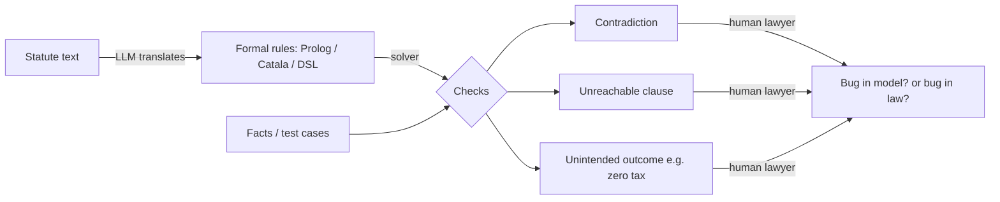

# Human-Written Rules as Code and How LLMs Deal With It

> [!NOTE]
> **One-paragraph summary**
> Software agents now find and exploit bugs in code. The question here: can the same approach work on human-written rules such as statutes, tax codes, and financial regulation? The short answer is "partly, and only after a translation step." Rules written in natural language are not executable. The field called **Rules as Code** (RaC) tries to make them executable. LLMs enter in three roles: as a direct reasoner over the text, as a translator from text to formal code, and as an adversarial searcher for loopholes. The evidence so far (2022-2026) says the translator role works best, the direct reasoner is brittle, and the searcher is real but unproven at scale.

---

## 1. Why the software analogy is tempting, and where it breaks

A bug hunter needs three things: a target that runs, an oracle that says "this is wrong," and a search method. Software has all three. Law has none of them by default.

| Software | Law / regulation |
|---|---|
| The target executes. | The text is read by humans. It does not run. |
| An oracle exists: crash, wrong output, failed assert. | The oracle is a court or an agency, often years later. |
| An exploit is clearly a defect. | A "loophole" is often legal until the legislature closes it. |
| Patch cycle: days. | Patch cycle: a legislative session, or never. |
| One codebase, one version. | Many jurisdictions, overlapping versions, cross-references. |

So the first job in every project below is to manufacture the missing pieces: build an executable model, then define what "wrong" means (contradiction, unreachable clause, unintended zero tax), then search.

> [!NOTE]
> **Terminology**
> - **Rules as Code (RaC):** writing legislation or policy so that a machine-readable version exists alongside the natural-language version.
> - **Computational law:** the broader academic field (Stanford CodeX, IAAIL).
> - **Statutory reasoning:** applying a statute to a set of facts; the benchmark task for LLMs.

---

## 2. Rules as Code: a short history

This idea is older than LLMs by decades.

1. **1977 — TAXMAN** (McCarty). First attempt to model a tax statute in a knowledge representation.
2. **1986 — British Nationality Act as a logic program** (Sergot, Sadri, Kowalski, Kriwaczek, Hammond, Cory). A large part of the 1981 Act in Prolog. Showed both that it is possible and that the act had gaps.
3. **2017 — "A Logic for Statutes"** (Lawsky). Argued that default logic, not classical logic, fits tax law, because statutes are full of exceptions and "notwithstanding" clauses.
4. **2018 — "Better Rules"** (New Zealand). Governments start to draft rules with coders in the room. OECD's *Cracking the Code* report (2020) made it a policy movement.
5. **2021 — Catala** (Merigoux, Chataing, Protzenko). A programming language built for statutes. Default logic in the core. A lawyer and a programmer encode the text side by side. Encoding the French housing benefit and tax code found real inconsistencies in the law.
6. **Ongoing — OpenFisca, PolicyEngine, L4 (Singapore), Blawx (Canada).** Executable models of tax and benefit systems, used for simulation and eligibility checks.

What RaC gives you: an executable target, a place to put test cases, and solver-based checks (consistency, reachability, coverage). In other words, it builds the oracle that software gets for free.

What RaC costs you: every encoding choice is an interpretation. When the statute is vague, the coder picks one reading. The code then looks more certain than the law is.

---

## 3. Why law resists being code

These are the places where the translation step fails or lies.

- **Open texture.** Terms like "reasonable," "ordinary course of business," or "principal residence" have no fixed boundary. Hart's old point: every rule has a core of settled cases and a penumbra of unsettled ones.
- **Defeasibility.** Rules have exceptions, exceptions to exceptions, and priority clauses. Classical logic handles this badly. Catala and LegalRuleML use default or defeasible logic for this reason.
- **Cross-references and time.** A section points to another section, which was amended last year. The "current" law is a merge of many versions.
- **Undefined or shifting definitions.** The same word means different things in different titles of the same code.
- **Discretion and judge-made law.** Case law, anti-abuse doctrines (economic substance, step transaction), and agency guidance sit outside the statute text but decide the outcome.
- **Intent.** A loophole is a mismatch between what the text allows and what the drafters meant. Intent is not in the text.

> [!WARNING]
> **The core trap**
> A formal model of a statute can be internally consistent and still be wrong as law. Consistency checks find bugs in the *model*. Whether they are bugs in the *law* needs a lawyer.

---

## 4. How LLMs deal with it: three roles

### 4.1 LLM as direct reasoner over the text

Give the model the statute and the facts, ask for the outcome.

- **SARA** (StAtutory Reasoning Assessment, 2020) tested this on a slice of the US Internal Revenue Code. Off-the-shelf reading models did poorly, with or without legal fine-tuning. A hand-built Prolog system solved the task fully, which already hints at the translator role below.
- **"Large Language Models as Tax Attorneys"** (Nay et al., 2023) showed steady improvement with each model generation, but still far from reliable.
- **"Solving versus Verifying"** (2026) found a specific weakness: models answer confidently even when the inputs contradict each other. They do not notice the contradiction.

Verdict: useful for first-pass reading and issue spotting. Not an oracle. The model has the same open-texture problem as a human, plus hallucinated citations and sensitivity to phrasing.

### 4.2 LLM as translator: text to formal code

The model writes the Prolog, Catala, or DSL. A solver does the checking.

- **IRC §121 in Prolog** (Loyola, Nov 2025). GPT-4o translated the section. The solver then found a known inconsistency every time. The same LLM used as a reasoner found it one time in three. Only one inconsistency was tested, so this is a proof of concept, not a measurement.
- **"Can AI expose tax loopholes?"** (2025). Tax rules compiled into a DSL, then a search over tax plans. Aimed at policy makers.
- **LegalWiz** (2025). A multi-agent pipeline that generates controlled contradictions, so detectors can be benchmarked.
- **Municipal code conflict detector** (prior-art disclosure). LLM flags, first-order logic confirms, to cut false positives.

Verdict: this is the strongest pattern. The LLM removes the expensive manual step (encoding), and the solver provides determinism. The open problem is **faithfulness**: did the model encode what the statute says, or what it expected the statute to say? The encoding-is-interpretation problem from Section 2 returns, now hidden inside a model.

### 4.3 LLM as adversarial searcher

Ask the model to find the exploit, then check it.

- **Shelter Check** (Blair-Stanek, Holzenberger, Van Durme, 2022). Proposal: scan proposed tax rules for unintended shelters before enactment. Framed as a tool for the IRS and Congress, because the same tool helps tax planners.
- **"Can LLMs Identify Tax Abuse?"** (same group, AAAI 2026). Three tasks: check a given strategy, complete a partial one, build one from scratch. Frontier models can do the first two with help and sometimes the third.
- **First LLM-generated shelter** (2025). An OpenAI reasoning model produced a novel strategy. The authors think it would lose in court and would be a reportable transaction. They still call it a warning for revenue.
- **Pre-LLM precedents.** The AI Economist (preprint 2020, published 2022) had RL agents learn to game a tax policy while a planner agent set it. The agents developed tax-gaming strategies, and the planner still beat the baselines. MIT's tax co-evolution work (2015, journal version 2016) evolved partnership shelters (the iBOB scheme) against evolving audit rules. Van 't Riet and Lejour (2014) modelled the tax-treaty network as a graph and ran shortest-path search for the lowest-tax route through 108 jurisdictions. These show the search part never needed an LLM. The LLM adds the ability to read the text and to propose steps a graph search would not represent.

Verdict: real, but no end-to-end system yet. Each project covers one section, one network, or one typology. There is no "scan the whole statute book" result.

---

## 5. Where pure code already exists: finance

In one domain the rules are already executable: smart contracts and exchange matching engines.

- LLM agents generate working exploits against DeFi contracts (2025 work on agent-based exploit generation). This is the software case, not the law case, and it works the same way.
- Formal verification firms (for example Imandra) verify exchange logic against regulatory text. The regulatory text still needs human encoding.
- Anti-money-laundering work in 2026 is mostly defensive: agents that investigate alerts faster (FIS with Anthropic, May 2026). Offensive benchmarks for structuring or sanctions evasion exist only as early packages with no published results.

The lesson: when the rules are code, LLM red-teaming works today. When the rules are text, the translator step decides everything.

---

## 6. Failure modes to watch for

- **No ground truth.** Most studies test against one or a few known bugs. A 100 % hit rate on one inconsistency means little.
- **Faithfulness of translation.** No standard way yet to verify that the formal model matches the text.
- **Confident contradictions.** Models do not flag inconsistent inputs unless asked.
- **Benchmark leakage.** Public statutes and famous loopholes are in training data. Novel-strategy claims need care.
- **Dual use.** A loophole finder for the tax agency is a loophole finder for the tax planner. Most authors address this by framing for agencies, not by withholding methods.
- **The "legal" exploit.** The output is a policy input, not a patch. Fixing it needs a legislature.

---

## 7. The feedback loop (my reading)

If governments draft law in a machine-readable form, two things happen at once:

1. LLM-driven exploitation gets easier, because the translation step disappears.
2. LLM-driven patching gets easier, for the same reason. Shelter Check becomes a pre-enactment test suite.

The net effect depends on who runs the tests first. The current projects all bet on the agencies. The treaty-network result suggests that for cross-border tax, the "attackers" already run graph search and have for a decade.

> [!WARNING]
> **Open questions**
> - Can an LLM's formal encoding be audited the way a human encoding is, clause by clause?
> - Is there a useful oracle short of a court? Candidates: "zero tax with no economic substance," "two clauses give different outcomes on the same facts," "a clause is unreachable."
> - Does machine-readable drafting change what legislators write? Early RaC reports say yes: vague clauses get flagged at drafting time.

---

## 8. Training on history: judgments, amendments, and past schemes

The software pattern is: sandbox the agent, give it a verifiable reward, let it search. Can law copy this with history as the signal? Three variants, and what exists for each.

### 9.1 Learn from past court judgments
- **Judgment prediction** (facts in, outcome out) exists since 2016 (ECHR), with large Chinese and Indian datasets. A Dec 2025 PPO attempt on Indian courts underperformed supervised baselines (ReGal). These models predict judges; they do not find holes.
- **RL with verifiable rewards for law.** Legal∆ (2025) rewards reasoning quality in legal QA. *Closing the Loop* (June 2026) is the closest to a sandbox: an LLM formalizes law into a Catala-based calculus, a verifier checks it, the check is the reward. The oracle is the formal model, not a court.

### 9.2 The era problem
A frontier model given the 1999 code will recite Son-of-BOSS from Wikipedia. That is leakage, not discovery.
- **ChronoGPT / ChronoBERT** (He, Lv, Manela, Wu, 2025): models trained only on text that existed before each cutoff date, built to remove lookahead bias in finance. Small, but competitive. Nobody has yet pointed one at a historical statute.

### 9.3 Reproduce past schemes
- *Can LLMs Identify Tax Abuse?* (AAAI 2026) does this directly: check, complete, or build known strategies. Gold labels come from the tax world's "CVE list": IRS listed transactions (Son-of-BOSS = Notice 2000-44), UK DOTAS, OECD BEPS reports. Each names the exploited provision and the patch.
- Weakness: leakage again. Only the one novel strategy escapes it.

### 9.4 Amendments as "patch commits"
Software agents train on (vulnerable commit, fix) pairs. Law has the raw material: a 2025 TU Munich dataset has 908 amendment–law pairs from the German Federal Law Gazette. It was used to test consolidation (50 % exact for single-step, 20 % for multi-step chains), not to label holes. Nobody has flipped it to "the diff marks the bug." Closest: a Polish paper predicting whether a bill will draw Senate amendments.

### 9.5 Why the loop stays open
- **Reward is late and noisy.** Courts rule on one fact pattern years later. Amendments can be politics, not bug fixes. Many schemes were legal and never patched.
- **Labels are scarce.** A few dozen US listed transactions versus 200,000+ CVEs. Enough to evaluate, not to train with RL.
- **The simulator is the bottleneck.** Dense reward needs executable law at date T. Catala and OpenFisca cover a few codes, with versioning. The agent will exploit bugs in the model before bugs in the law (which is how Catala found its own errors).
- **Era-restricted models are weak.** Less data, no modern reasoning post-training.

> [!NOTE]
> **A workable design (sketch)**
> 1. Pick a statute with a known patched hole. Cum-ex is a good candidate: the hole was in withholding-tax refund mechanics around the dividend record date; Germany closed it in 2012.
> 2. Encode the pre-2012 rules in Catala or OpenFisca. Tax owed and refund paid become the reward.
> 3. Run the agent with retrieval limited to pre-2012 sources, or a Chrono-style model.
> 4. Add an anti-abuse checker as a penalty, so pure fraud does not win.
> 5. Score: did it rediscover the scheme, and how many model bugs did it find first?
>
> MIT's 2015 co-evolution work did steps 2–5 for one partnership shelter with genetic programming. Nobody has done it with an LLM and a time cutoff.

### 9.6 References for this section
- *ReGal: A First Look at PPO-based Legal AI for Judgment Prediction and Summarization in India.* Dec 2025. <https://arxiv.org/abs/2512.18014>
- *Legal∆: Enhancing Legal Reasoning in LLMs via RL with Chain-of-Thought Guided Information Gain.* 2025. <https://arxiv.org/abs/2508.12281>
- *Closing the Loop: Formally Verified Law as a Reward Signal for Self-Improving Legal AI.* June 2026. <https://arxiv.org/abs/2606.23913>
- He, Lv, Manela, Wu. *Chronologically Consistent Large Language Models (ChronoBERT, ChronoGPT).* 2025. <https://arxiv.org/abs/2502.21206>
- *Risks and Limits of Automatic Consolidation of Statutes.* NLLP 2025. <https://aclanthology.org/2025.nllp-1.29>
- Polish legislative prediction dataset. 2025. <https://arxiv.org/abs/2503.12100>
- IRS Notice 2000-44 (Son-of-BOSS). Background: <https://en.wikipedia.org/wiki/Son_of_Boss>

---

## 9. Side thought: political forecasting and the 1914 test

Can an LLM forecast politics like a weather model forecasts weather? Measured answer for the near term: roughly as well as a good human crowd. For the long term: no, and for reasons specific to politics.

### 10.1 Measurements (2024–2026)
- **ForecastBench** (Forecasting Research Institute): live questions on elections, conflicts, economic data, weeks to months out. Mid-2026: superforecasters lead the best models by a small Brier margin; models beat the public. Parity projected for late 2026, but that is a trend line against a 2024 human baseline.
- **Weak spot: combination questions** ("A, then B"). The gap to humans grows a lot. War forecasts are chains of these.
- Halawi et al. (2024): retrieval + fine-tuned model reached the Metaculus crowd on short horizons.

### 10.2 Where the weather analogy breaks
1. **No physics.** A political forecast is a weighted average of what people wrote. Good exactly when the written consensus is good.
2. **Reflexivity.** The atmosphere does not read the forecast; voters, markets and generals do. An accurate forecaster becomes an actor.
3. **No base rate for rare events.** Tetlock: expert political forecasts past ~3–5 years are near chance. Decay is a cliff at the first surprise, not a smooth curve.
4. **Only resolvable questions get scored.** "General war by 1920?" is scorable. "What shape?" is not.

### 10.3 The 1914 test
Tools now exist: **GPT-1914** (trained on 1880–1914 text) and **TypewriterLM** (7B, English text before 1913, with a 2,344-event leakage benchmark). Nobody has asked them to forecast yet.
- Corpus content: arms race, alliance blocs, Balkan crises 1908–1913. So: war possible.
- Dominant printed view: Norman Angell, *The Great Illusion* (1910): long industrial war is irrational. Bond markets agreed until late July 1914.
- Minority view that was right: Ivan Bloch (1898), trench stalemate. A model averages, so it would underweight him.
- Expected output: "war plausible, probably short, probably contained." The median 1914 opinion, wrong on the two points that mattered. **The model fails the way the crowd failed, because the model is the crowd.**

### 10.4 The 1939 test
By 1938 most of the written record expected a European war. A pre-1939 model gets the direction right and misses what experts missed: Molotov–Ribbentrop, France in six weeks, Pearl Harbor. Same pattern as ForecastBench: single events fine, chains poor.

> [!NOTE]
> **Caveat on the experiment**
> GPT-1914 and TypewriterLM are base models: no instruction tuning, no reasoning post-training. Their output shows what the 1913 corpus believed, not what a modern reasoning model with only 1913 knowledge would believe. The second question has no clean tool yet. Same era-leak problem as [Section 8](#8-training-on-history-judgments-amendments-and-past-schemes).

### 10.5 References for this section
- Forecasting Research Institute, *LLMs Are Closing the Gap on Human Superforecasters* (2026). <https://forecastingresearch.substack.com/p/llms-are-closing-the-gap-on-human>
- Forecasting Research Institute, *How well can large language models predict the future?* <https://forecastingresearch.substack.com/p/ai-llm-forecasting-model-forecastbench-benchmark>
- ForecastBench. <https://www.forecastbench.org/>
- Halawi, Zhang, Yueh-Han, Steinhardt. *Approaching Human-Level Forecasting with Language Models.* 2024. <https://arxiv.org/abs/2402.18563> (arXiv id from memory, unverified)
- *Can Language Models Represent the Past without Anachronism?* (GPT-1914). 2025. <https://arxiv.org/abs/2505.00030>
- *Pretraining Language Models on Historical Text* (TypewriterLM). 2026. <https://arxiv.org/abs/2606.02991>
- Tetlock. *Expert Political Judgment.* 2005. Tetlock & Gardner. *Superforecasting.* 2015.
- Ferguson. *The Pity of War.* 1998 (markets and the July 1914 crisis). Angell. *The Great Illusion.* 1910. Bloch. *Is War Now Impossible?* 1899.

---

## 10. The superclass: "humans cannot learn from history; can an LLM?"

### 11.1 The premise is half wrong
Humans do learn, at the institutional level: central banks after 1929 acted in 2008; the nuclear taboo, the EU, the WHO, deposit insurance are learned responses. What fails is four specific things. Each maps onto a different LLM property.

| Failure mode | Literature | LLM property | Verdict |
|---|---|---|---|
| **Generational forgetting.** Lessons die with the people who lived them (1918 flu → 2020; crises recur about once per career). Jervis: leaders learn from dramatic events they experienced early in life, and overgeneralize. Minsky: stability breeds the next crisis. | Jervis 1976; Minsky 1992 | Does not forget. All history in the weights at once, no personal-youth bias. | Real advantage. But memory was never the bottleneck: Bloch (1899) was in every library in 1914; Reinhart–Rogoff data were known in 2007; Chuck Prince (July 2007) knew the music would stop. |
| **Wrong lesson by salient analogy.** "Munich" produced Vietnam and Iraq. | Neustadt & May 1986; Khong 1992 | An analogy engine weighted by corpus frequency. Munich/Hitler over-represented. ACL 2025 found stereotyped analogies, needed a self-reflection step. 2026 review: history performance collapses on clean data and open questions. | Likely repeats the Munich error, with more fluency. |
| **Incentives.** The actor knows and still cannot act early. | Olson; Keynes ("fail conventionally") | Holds no power. As advisor, serves a principal with the same incentives. RLHF sycophancy = the court astrologer, automated. | No help; possibly worse. |
| **Next tragedy has a different shape.** Generals plan the last war (Maginot = lesson of 1916). Learning changes the system. Only scored, updating forecasters ("foxes") improve. | Tetlock 2005 | Base-rate machine: says "this time is not different" more consistently on patterns that rhyme (leverage cycles). Nothing on novel shapes. Feedback loop exists only in ForecastBench-style scoring, which is new. | Mixed. |

### 11.2 One-line answer
An LLM fixes the one failure that was never the real cause (memory), reproduces the two that were (salient analogy, sycophancy toward power), and does nothing about incentives. The right question is whether a scored, non-sycophantic model inside an institution with power to act would be listened to. That is the Bloch question of 1899.

### 11.3 Where the discussion lives
- Jervis. *Perception and Misperception in International Politics.* Princeton University Press, 1976 (new ed. 2017). Ch. 6, "How Decision-Makers Learn from History" (pp. 217–287 in the 2017 ed.). <https://muse.jhu.edu/book/64616>
- Neustadt & May. *Thinking in Time: The Uses of History for Decision-Makers.* Free Press, 1986 (paperback 1988). Grew out of the Kennedy School course "The Uses of History."
- Khong. *Analogies at War: Korea, Munich, Dien Bien Phu, and the Vietnam Decisions of 1965.* Princeton University Press, 1992. <https://press.princeton.edu/books/paperback/9780691025353/analogies-at-war>
- Reinhart & Rogoff. *This Time Is Different: Eight Centuries of Financial Folly.* Princeton University Press, 2009.
- Minsky. *The Financial Instability Hypothesis.* Levy Economics Institute Working Paper No. 74, May 1992. <https://levyweb.bard.edu/wp-content/uploads/2024/02/wp74.pdf>
- Tetlock. *Expert Political Judgment: How Good Is It? How Can We Know?* Princeton University Press, 2005. <https://en.wikipedia.org/wiki/Expert_Political_Judgment>
- Turchin, cliodynamics; team posts on LLMs for historical data, early 2026 (paywalled). <https://peterturchin.substack.com/p/the-feverish-library>
- Harvard Belfer Center, Applied History Project (Allison, Ferguson).
- Li, Yuan, Chen, Liang, Wei, Liang, Yang, Xiao. *Past Meets Present: Creating Historical Analogy with Large Language Models.* ACL 2025 Long Papers, pp. 3942–3957, Outstanding Paper. <https://aclanthology.org/2025.acl-long.200> — arXiv: <https://arxiv.org/abs/2409.14820>
- Das & Balke. Analogy benchmark with several plausible options. INLG 2025. <https://aclanthology.org/2025.inlg-main.28>
- *The AI-Augmented Research Process: A Historian's Perspective.* 2025. <https://arxiv.org/abs/2508.01779>
- *LLMs4All* review, history section. 2025. <https://arxiv.org/abs/2509.19580>
- Review of five historical-competence benchmarks (contamination, Western bias, MCQ vs open). March 2026. Not retrieved; search "ProHist-Bench" and "historical reasoning benchmarks 2026".

---

## 11. References

### Papers and reports
- Blair-Stanek, Holzenberger, Van Durme. *Shelter Check: Proactively Finding Tax Minimization Strategies via AI.* Tax Notes, 2022. <https://www.taxnotes.com/featured-analysis/shelter-check-proactively-finding-tax-minimization-strategies-ai/2022/12/09/7ffkx>
- Blair-Stanek, Holzenberger, Van Durme. *Can LLMs Identify Tax Abuse?* AAAI 2026. <https://arxiv.org/abs/2508.20097>
- *ChatGPT Generates a Novel Tax Strategy.* TaxProf Blog, Jan 2026. <https://taxprofblog.aals.org/2026/01/25/chatgpt-generates-a-novel-tax-strategy/>
- *Can AI expose tax loopholes? Towards a new generation of legal policy assistants.* 2025. <https://arxiv.org/abs/2503.17339>
- *LLM-Assisted Formalization Enables Deterministic Detection of Statutory Inconsistency in the Internal Revenue Code.* Nov 2025. <https://arxiv.org/abs/2511.11954>
- *LegalWiz: A Multi-Agent Generation Framework for Contradiction Detection in Legal Documents.* 2025. <https://arxiv.org/abs/2510.03418>
- *Solving versus Verifying: Catching Contradictions in Tax Reasoning Systems.* 2026. <https://arxiv.org/abs/2609.05928>
- Nay et al. *Large Language Models as Tax Attorneys.* Phil. Trans. A, 2023.
- Holzenberger, Blair-Stanek, Van Durme. *A Dataset for Statutory Reasoning in Tax Law Entailment and Question Answering (SARA).* NLLP Workshop, 2020. <https://arxiv.org/abs/2005.05257> — project page: <https://nlp.jhu.edu/law/sara>
- Merigoux, Chataing, Protzenko. *Catala: A Programming Language for the Law.* ICFP 2021. <https://catala-lang.org/>
- Lawsky. *A Logic for Statutes.* 21 Florida Tax Review 60 (2017). <https://scholarship.law.ufl.edu/ftr/vol21/iss1/2/>
- Sergot, Sadri, Kowalski, Kriwaczek, Hammond, Cory. *The British Nationality Act as a Logic Program.* Communications of the ACM 29(5), 370–386, 1986. <https://doi.org/10.1145/5689.5920>
- Zheng, Trott, Srinivasa, Parkes, Socher. *The AI Economist: Taxation Policy Design via Two-Level Deep Multiagent Reinforcement Learning.* Science Advances 8(18), eabk2607, 2022. <https://doi.org/10.1126/sciadv.abk2607>
- Hemberg, Rosen, Warner, Wijesinghe, O'Reilly. *Tax Non-Compliance Detection Using Co-evolution of Tax Evasion Risk and Audit Likelihood.* ICAIL 2015, 79–88. <https://doi.org/10.1145/2746090.2746099>
- Hemberg, Rosen, Warner, Wijesinghe, O'Reilly. *Detecting Tax Evasion: A Co-Evolutionary Approach.* Artificial Intelligence and Law 24(2), 149–182, 2016. <https://doi.org/10.1007/s10506-016-9181-6> — open access: <https://dspace.mit.edu/handle/1721.1/105846>
- Van 't Riet, Lejour. *Ranking the Stars: Network Analysis of Bilateral Tax Treaties.* CPB, 2014. <https://www.cpb.nl/sites/default/files/publicaties/download/cpb-discussion-paper-290-ranking-stars.pdf>
- OECD OPSI. *Cracking the Code: Rulemaking for Humans and Machines.* 2020. <https://oecd-opsi.org/publications/cracking-the-code/>
- Palmirani. ICAIL 2025 talk on AI for legislative analysis. <https://site.unibo.it/hypermodelex/en/agenda/icail2025/01-palmirani-2025-06-19-v2.pdf/@@download/file/01.Palmirani-2025-06-19-v2.pdf>
- *Agentic AI for Financial Crime Compliance.* 2025. <https://arxiv.org/abs/2509.13137>
- FIS and Anthropic, Financial Crimes AI Agent press release, May 2026. <https://www.fisglobal.com/about-us/media-room/press-release/2026/fis-brings-agentic-ai-to-banking-with-anthropic-starting-with-financial-crimes>

### Sites to follow
- Stanford CodeX — <https://law.stanford.edu/codex/>
- IAAIL / ICAIL / journal *Artificial Intelligence and Law* — <https://www.iaail.org/>
- Catala — <https://catala-lang.org/>
- PolicyEngine — <https://policyengine.org/>
- OpenFisca — <https://openfisca.org/>
- TaxProf Blog — <https://taxprofblog.aals.org/>
- Tax Justice Network — <https://taxjustice.net/>

