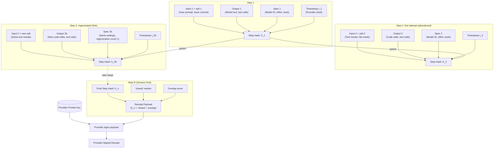
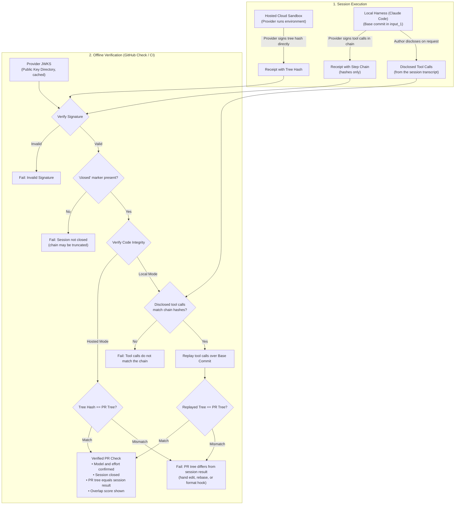
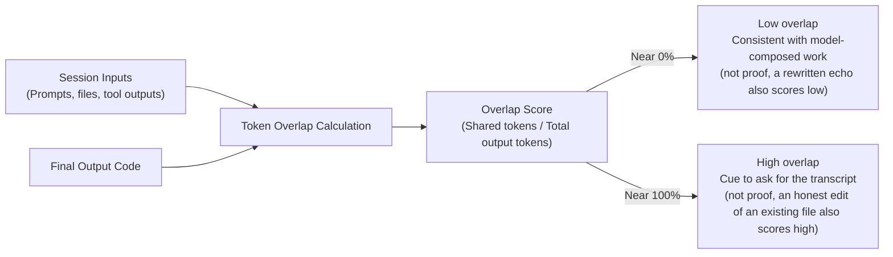

# Certified AI-Generated Work: Design Notes

**Date:** 2026-10-13
**Status:** working notes from a chat session. Idea by scsnake. Drafted with Claude Fable 5.1 from my idea.
**Related:** [Provider-Signed Session Receipts](provider_signed_session_receipts.md) (the short proposal)

## 1. The idea

Most AI provenance work answers one question: "is this AI-generated, when it claims to be human?" This note is about the opposite question. In a world where top models beat the average human, a claim such as "this PR was made by Fable 5.1" carries information. It tells a reviewer, and the next agent in the pipeline, what quality to expect.

Today that claim is free text. Anyone can write it. The goal is a **certificate**: a verifiable statement that a given output came from the model it names, and was not changed by a human afterward.

Two points about scope:

- The certificate does not say the output is good. It says who produced it. The quality prior comes from the reader, not the certificate.
- The certificate covers the artifact or the full session. It does not judge intent.

## 2. What exists today (October 2026)

| Layer | Status | What it proves | Gap for this idea |
|---|---|---|---|
| Text watermark (SynthID-Text; Gemini since 2024, Claude since Aug 2026) | Deployed | Some model from this provider touched the text | Detect-only. Not per tier. Weak on short code. Edits remove it. Detection limited to eligible parties. |
| C2PA 2.4 `c2pa.ai-disclosure` | Deployed for files | Signer's claim about model and oversight | Fits images and files, not git diffs. Only as good as the signer. |
| Git trailers (`Co-Authored-By`) | Convention | Nothing | Anyone can type it. Squash drops it. |
| GitHub app-signed commits (Copilot cloud agent, Claude GitHub App) | Deployed | Which app pushed the commit | Not the model, not the session. Closest shipped signal for a PR. |
| Third-party attestations (agent-attest, agentattest; in-toto, Sigstore) | Early | Chain of custody from the runner | The runner signs, so the model claim is unverifiable. |
| Web Bot Auth (IETF WG draft, Sept 2026) | In standards track | Which operator sent a request | Operator identity, not model. Good building block for key discovery. |
| TEE attestation, zkML (IETF SPICE inference-chain draft, March 2026) | Research, drafts | Which weights ran | No major vendor sells it. zkML limited to ~100M params. |
| EU AI Act Art. 50 and Code of Practice (in force since 2 Aug 2026) | Law | Pushes "is this AI" marking | Asks for marking, not model-tier attestation. |

Conclusion: no deployed mechanism gives a positive, third-party-verifiable claim of "this model tier produced exactly this."

## 3. Core design: a provider-signed session receipt

### 3.1 Why the provider must sign

Only the provider knows which weights ran. A runner-side attestation can only repeat what the runner believes. So the receipt must be signed with a provider key. Everything else can be client-side.

### 3.2 Chain

For each step `i`:

```
h_i = H( h_(i-1) || H(salt_i || input_i) || H(output_i) || spec_i || t_i )
```

- **input_i** includes user text, system prompt, tool results, and attached files. In agent sessions most input is tool output. Hash it, or a person can smuggle hand-written code in through a file read.
- **output_i** is the exact bytes emitted, including tool calls. Hidden reasoning is committed as a separate hash.
- **spec_i** holds model ID, snapshot, reasoning effort, sampling settings, tool list, harness version. Effort and tools matter for the quality prior. "Fable at low effort, no tools" and "Fable at high effort with a test loop" are different objects.
- **t_i** is the provider timestamp.
- **salt_i** stops dictionary guessing of short inputs.



### 3.3 Signatures, not encryption

Hashing gives integrity. A signature gives authenticity. Encryption only hides, and a hash already hides. The provider signs the chain head plus a `closed` marker at session end. Public keys live in a JWKS at a well-known URL, as in Web Bot Auth. Verification is offline. The provider stores heads only for disputes and revocation.

### 3.4 On "blockchain"

A single-provider hash chain is a Merkle log, like Certificate Transparency. A public log adds one property: the provider cannot backdate or rewrite a receipt later. Use a transparency log or an RFC 3161 timestamp if that matters. For the base use case it is optional.

### 3.5 Forks and prefixes

- A regenerated turn forks the chain. Record a parent pointer and a regeneration counter.
- Any prefix of a valid chain is also valid. Without a `closed` marker, a person can stop at the good step and hide later mistakes. The marker fixes this.

### 3.6 Selective disclosure

The receipt holds only hashes. The author reveals the transcript on request. The verifier checks each message against its hash. Private prompts stay private.

## 4. Binding to a PR

The model emits edits, not a final file. Two options:

1. **Replay.** Base commit hash goes into the first input. The verifier replays the tool calls over that base and compares to the PR tree. A hand edit after the session breaks the match. Works with a local harness, because the harness cannot change what the provider signed.
2. **Hosted execution.** When the provider runs the sandbox, it signs the final tree hash directly. Simplest. Managed Agents and cloud sessions are the natural first home.



## 5. The echo attack and the overlap score

A valid chain proves integrity and origin, not authorship. Write the PR by hand, give it to Fable, say "output this verbatim." The chain is honest and the quality signal is gone.

Fix: the provider computes an **overlap score** at session end, the fraction of final-output tokens that also appear in session inputs, and signs it inside the spec. Near 0% means composed. Near 100% means copied. Cheap, mechanical, no judgment. A high score is a cue to ask for the transcript.

Known weakness: the score is defined on the final output. An echo in a middle turn, then lightly rewritten, scores low. A per-turn score or an n-gram overlap against all prior inputs would close this, at some cost.



## 6. What the certificate proves and does not prove

| Claim | Covered? |
|---|---|
| Output bytes are exactly what model X emitted | Yes |
| No human edit after the last step | Yes, via replay or hosted tree hash |
| No turn deleted or inserted | Yes |
| Receipt not forged | Yes, needs provider key |
| Session shown is the full session | Only with the `closed` marker |
| Content authored by the model, not copied from input | No. Overlap score and disclosure help. |
| Human did not run 50 sessions and pick one | No. Accept it. Same as a human with ten drafts. |
| Provider is honest, key not compromised | Assumed. Rotation, transparency log, later TEE. |

## 7. Threat list

| Attack | Result |
|---|---|
| Edit output after session | Hash mismatch, replay fails |
| Forge a receipt | Needs provider private key |
| Truncate the chain | Caught by `closed` marker |
| Hide a regeneration | Parent pointer and counter make it visible |
| Echo hand-written content through the model | Not blocked. Overlap score flags it. |
| Smuggle content via tool results | Hashed as input, visible on disclosure, counts toward overlap |
| Replay an old receipt on a new artifact | Hash binding fails |
| Local harness lies about tool results | It only commits to what it sent. Replay catches edits to the tree. |
| Backdate a receipt | Needs transparency log or RFC 3161 to block |
| Key compromise | Rotation plus log limits damage |

## 8. Fit with Anthropic products

- **Managed Agents, cloud sessions:** one signed receipt per session with final tree hash. Ship first.
- **Claude Code, local:** API returns a signed step hash per response. Claude Code appends to the session log and writes the receipt as a git note or a `Receipt:` trailer that points to a file. Replay verification covers the local harness.
- **GitHub check:** a GitHub App verifies the receipt and shows model, effort, turns, overlap score, replay match. Merge rules and downstream agents act on it.
- **API surface:** one response field, `receipt_hash`, and one endpoint, `GET /receipts/{session_id}`. These names are suggestions, not existing endpoints.

## 9. Open questions

- Canonical bytes: hash UTF-8 NFC text, and decide how to treat streaming and tool-call JSON ordering.
- Should the receipt cover thinking tokens as a committed hash, or exclude them?
- Per-turn overlap versus final-only overlap.
- Cross-provider format: in-toto statement shape, proposed through C2PA or IETF SPICE, so OpenAI and Google can issue the same receipt.
- Who runs the GitHub check, and should the badge be tier-aware ("Fable, high effort, tests ran") or just "receipt valid"?
- Privacy of overlap score when inputs are secret. The score leaks a little about the inputs. Likely acceptable.

## 10. Prior art and sources

- IETF draft, SPICE inference chain (March 2026): https://datatracker.ietf.org/doc/html/draft-mw-spice-inference-chain
- IETF draft, HTTP Message Signatures for Bots (Sept 2026): https://datatracker.ietf.org/doc/html/draft-ietf-webbotauth-httpsig-protocol-00
- C2PA Technical Specification 2.4: https://spec.c2pa.org/specifications/specifications/2.4/specs/C2PA_Specification.html
- Content Authenticity Initiative, state of 2026: https://contentauthenticity.org/blog/the-state-of-content-authenticity-in-2026
- Anthropic text watermark, TechCrunch (Aug 2026): https://techcrunch.com/2026/08/11/anthropic-says-it-will-watermark-text-generated-by-its-ai-models/
- EU Code of Practice on AI-generated content, Jones Day (June 2026): https://www.jonesday.com/en/insights/2026/06/european-commission-publishes-final-code-of-practice-on-marking-and-labelling-aigenerated-content
- agent-attest: https://github.com/zhengqiuyang/agent-attest
- agentattest: https://github.com/BlockTarioIQ/agentattest
- Red Hat, supply-chain provenance for AI agent identity: https://next.redhat.com/2026/08/07/supply-chain-provenance-for-ai-agent-identity/
- Fingerprinting AI Coding Agents on GitHub (MSR 2026): https://arxiv.org/html/2601.17406v1
- Feasibility taxonomy for inference-time AI governance: https://arxiv.org/pdf/2609.10105

---

License: [CC BY 4.0](https://creativecommons.org/licenses/by/4.0/)
