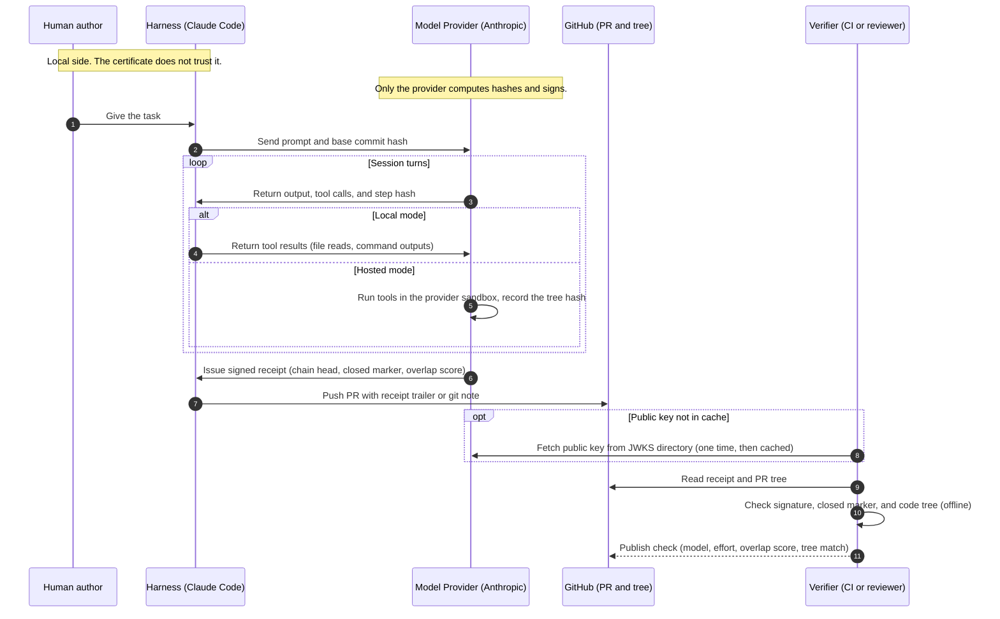
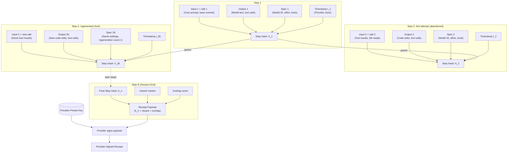
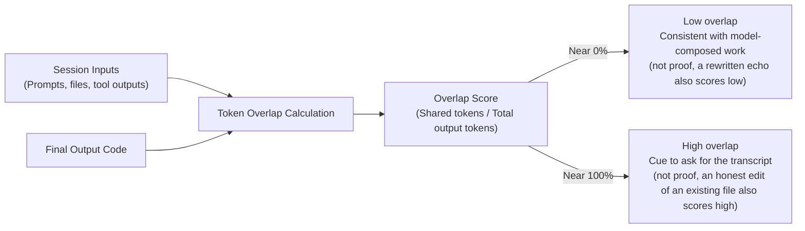
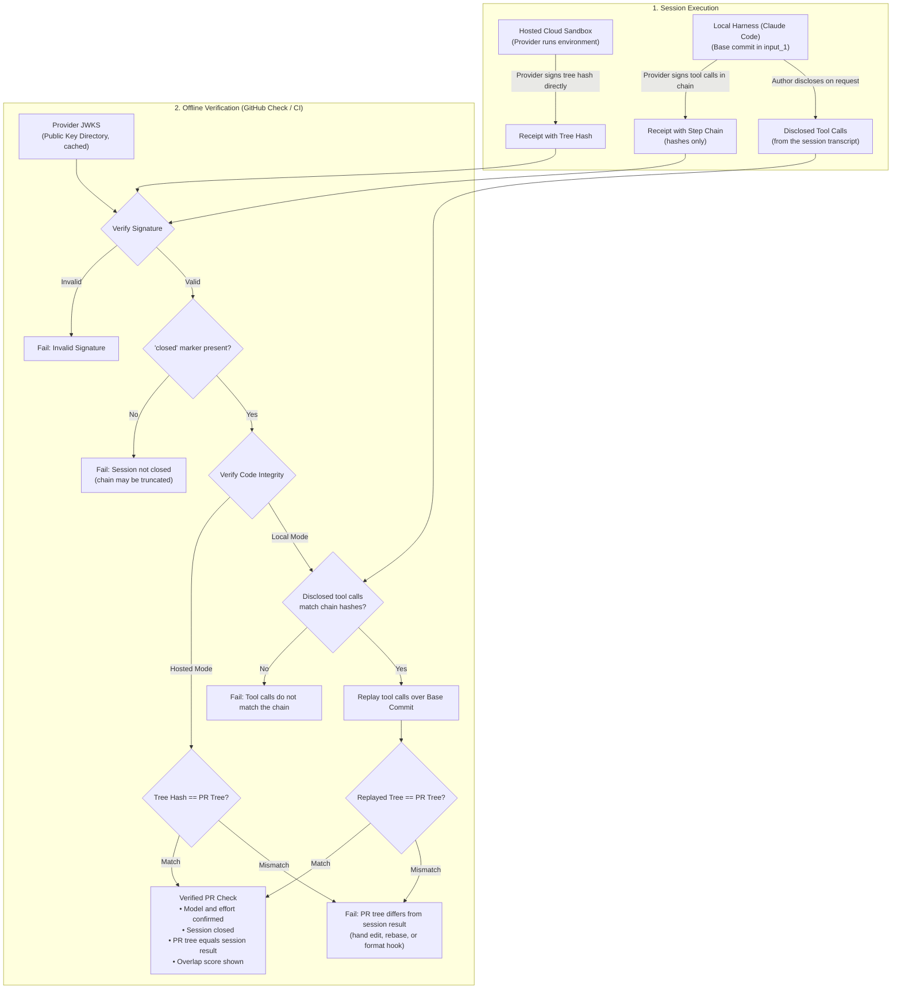

# Provider-Signed Session Receipts for Claude

**Proposal draft, 2026-10-13.** Idea by scsnake. Drafted with Claude Fable 5.1 from my idea.

## Summary

Today a person can claim "this PR was written by Claude Fable" and nobody can check it. A person can also edit Claude's output and still present it as pure model output. This proposal asks Anthropic to sign a small receipt for each session. The receipt proves two things: the output is the exact bytes that a named Claude model emitted, and no turn was changed, added, or removed after the fact. Verification works offline with a public key.

This is a positive certificate of origin. It is not a detector. Watermarks answer "did an AI touch this?" A receipt answers "did this model, with these settings, produce exactly this?"

## Why it is needed

1. **Model tier is a quality signal.** A PR made by Fable at high effort with tests is a different object from a PR made by Haiku at low effort. Reviewers, CI gates, and downstream agents can set trust by tier. Today the model name is a free-text trailer that anyone can type.
2. **Human edits hide inside model output.** A `Co-Authored-By` line survives a hand edit. A reviewer cannot tell which lines the model wrote and which lines a person changed afterward.
3. **Watermarks do not solve this.** Anthropic's SynthID-based text watermark is detect-only, limited to eligible parties, weak on short code, and not tied to a model tier. The watermark is still useful. The receipt is a different layer.
4. **The pieces already exist.** Each API call has a request ID. Claude Code already has the full transcript. GitHub already shows a "Verified" badge for app-signed commits. What is missing is a signature, a chain link, and a public key directory.

## Design

The diagram below shows the end-to-end lifecycle from prompt to verified PR check:



### Chain

For each step `i` in a session, the provider computes:

```
h_i = H( h_(i-1) || H(salt_i || input_i) || H(output_i) || spec_i || t_i )
```

- `input_i` is everything the model saw at that step: user text, system prompt, tool results, attached files. In an agent session most input is tool output. If tool output is not hashed, a person can smuggle hand-written code in through a file read.
- `output_i` is the exact bytes the model emitted, including tool calls. Hidden reasoning is committed as a separate hash and stays private.
- `spec_i` holds the model ID, model snapshot, reasoning effort, sampling settings, tool list, and harness version.
- `t_i` is the provider timestamp.
- `salt_i` is a random value per step. Short inputs like "yes" are easy to guess from a bare hash.

A regenerated turn creates a fork. Each step records its parent, so a verifier can see that a branch was not the first attempt.



### Signature

The provider signs the chain head together with a `closed` marker when the session ends. Keys are published as a JWKS at a well-known URL, in the same way as the IETF Web Bot Auth draft. A verifier checks the signature offline. No call to Anthropic is needed. Anthropic keeps the chain heads for disputes and key revocation. An optional append to a public transparency log stops anyone from backdating a receipt later.

### Selective disclosure

The receipt holds only hashes. The author reveals the full transcript only when a verifier asks. The verifier checks each revealed message against its hash. Private prompts stay private until the author decides.

## Overlap score

A valid chain does not prove authorship. A person can write a PR by hand, give it to Fable, and say "output this verbatim." The chain is honest, and the quality signal is gone.

To close this gap, the provider computes an **overlap score** at the end of the session and puts it in the signed spec. The score is the fraction of output tokens that also appear in the session inputs, measured on the final output only. A PR with overlap near 0% was composed by the model. A PR with overlap near 100% was copied. The score is cheap to compute, needs no judgment, and the provider already holds both sides.

A verifier who sees a high score can ask for the transcript. The echo prompt is then visible.



## Binding the receipt to code

The model emits edits, not a final file. Two ways to bind the receipt to a PR:

1. **Replay.** The base commit hash goes into the first input. The verifier replays the tool calls from the chain over that base commit and compares the result to the PR tree. If a person changed one line after the session, the replay does not match. This works with a local harness, because the harness cannot change what the provider signed.
2. **Hosted execution.** When the provider runs the sandbox, it signs the final tree hash directly. No replay is needed.



## Fit with Claude Code and Managed Agents

- **Managed Agents and cloud sessions.** This is the easiest place to start. The provider controls the model, the sandbox, and the clock. One signed receipt per session, with the final tree hash, covers the full chain. Ship this first.
- **Claude Code, local.** The API returns a signed step hash with each response. Claude Code appends the chain to the session log and writes the final receipt next to the commit, for example as a git note or a `Receipt:` trailer that points to a receipt file. Replay verification covers the local harness.
- **GitHub.** A GitHub App or Action verifies the receipt and shows a check: model, effort, number of turns, overlap score, replay match. Reviewers and merge rules can act on it. A downstream agent that reads the PR can set its own trust from the same check.
- **API.** Expose one field per response, `receipt_hash`, and one endpoint, `GET /receipts/{session_id}`, that returns the signed head. Everything else is client-side.

## What the receipt does not prove

- It does not prove the model authored the ideas. The overlap score and transcript disclosure help, and are not a full fix.
- It does not stop a person from running many sessions and keeping the best one. This is the same as a human who writes ten drafts. Accept it.
- It trusts Anthropic's key. A compromised key makes receipts from that key doubtful. Key rotation and a transparency log limit the damage. TEE attestation can reduce this trust later. The IETF SPICE inference-chain draft already combines the two.

## Next steps

1. Publish a receipt format. Reuse the in-toto statement shape with Anthropic as the "builder" and the session as the "build."
2. Add `receipt_hash` to API responses and a signed head at session close. Start with Managed Agents.
3. Add receipt writing and replay verification to Claude Code.
4. Publish a reference GitHub check.
5. Propose the format to C2PA and the IETF SPICE group so other providers can issue the same receipt.

## Prior art

- IETF draft, SPICE inference chain (March 2026): ordered inference logs with a Merkle root in a token.
- IETF draft, HTTP Message Signatures for Bots (September 2026): operator keys at a well-known URL.
- C2PA 2.4 `c2pa.ai-disclosure` assertion: model and oversight fields for files.
- in-toto and SLSA provenance: statement format for signed build claims.
- Anthropic text watermark (August 2026): detect-only layer that this proposal complements.

---

License: [CC BY 4.0](https://creativecommons.org/licenses/by/4.0/)
